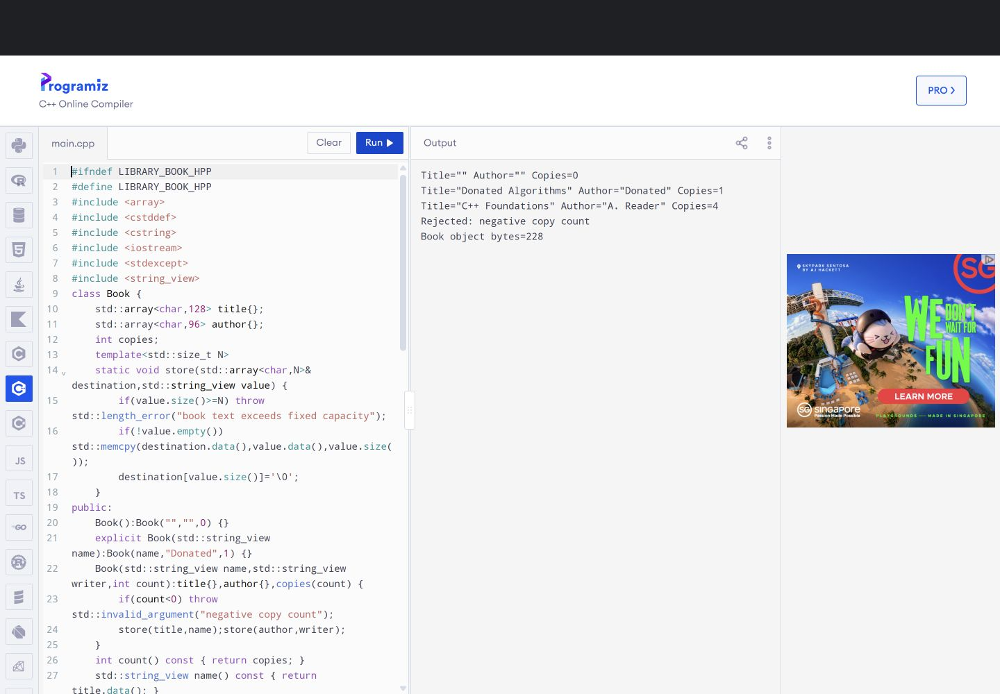
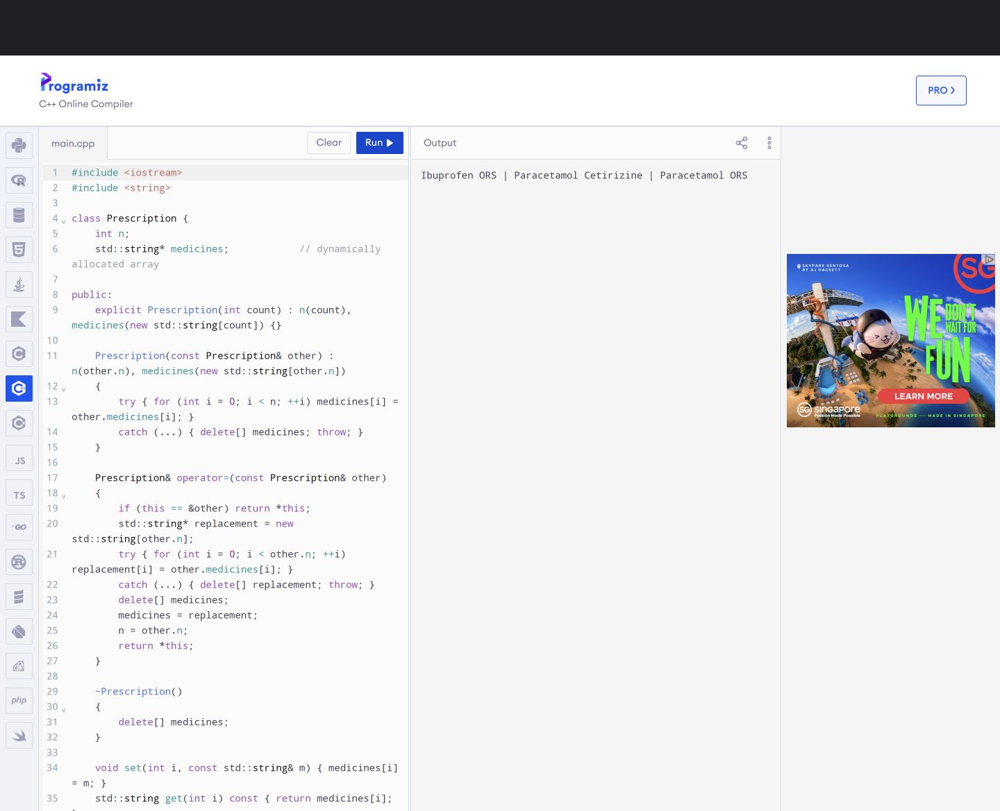
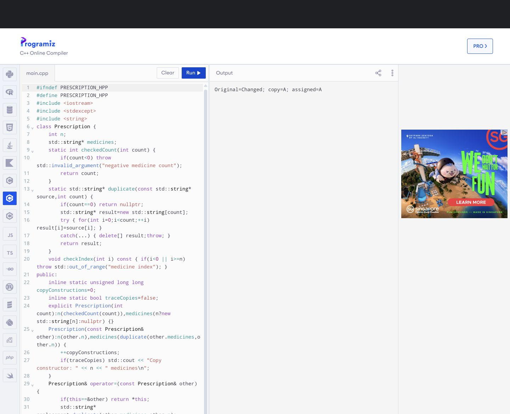
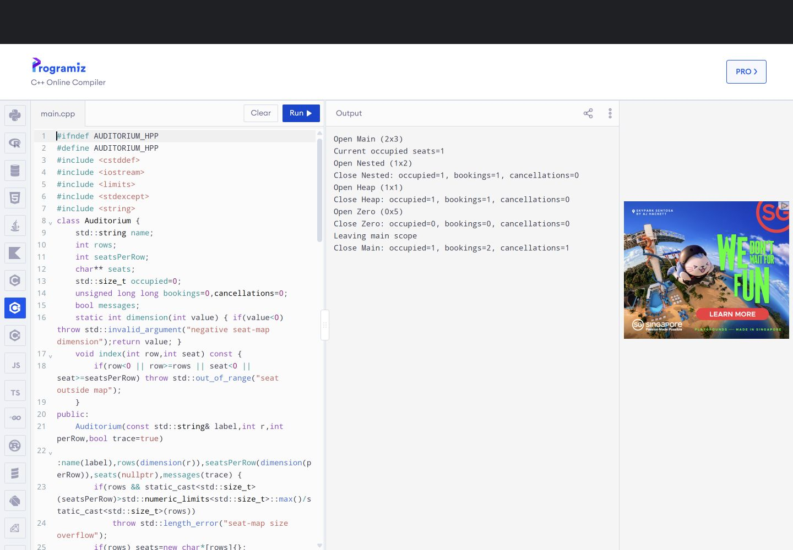
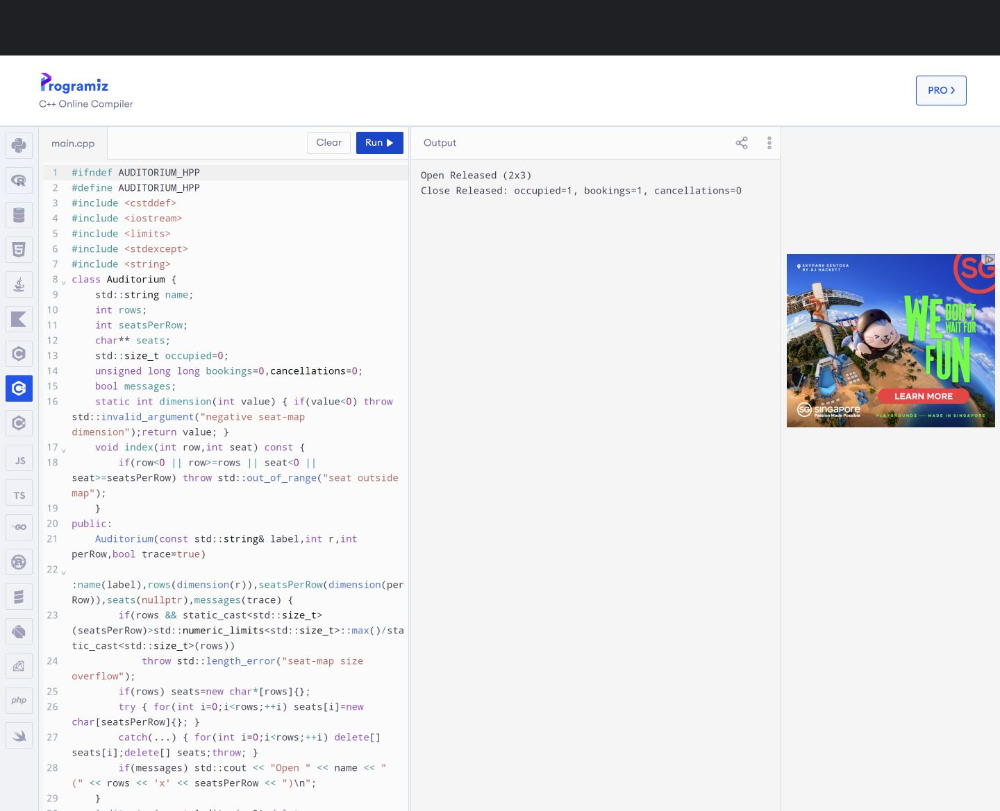
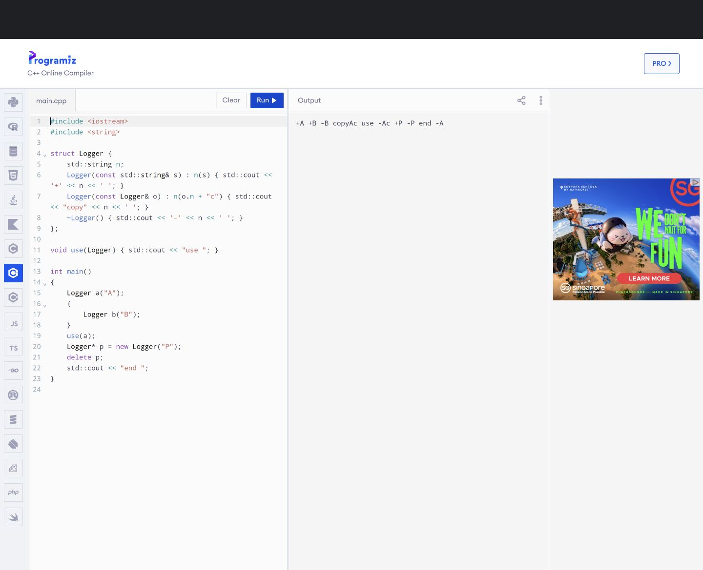
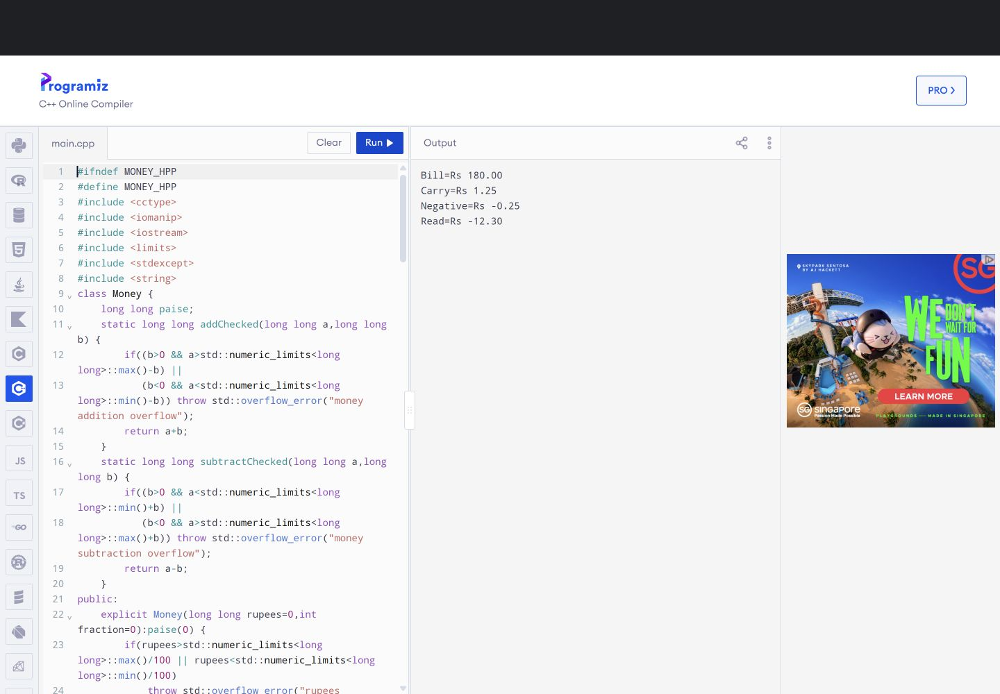
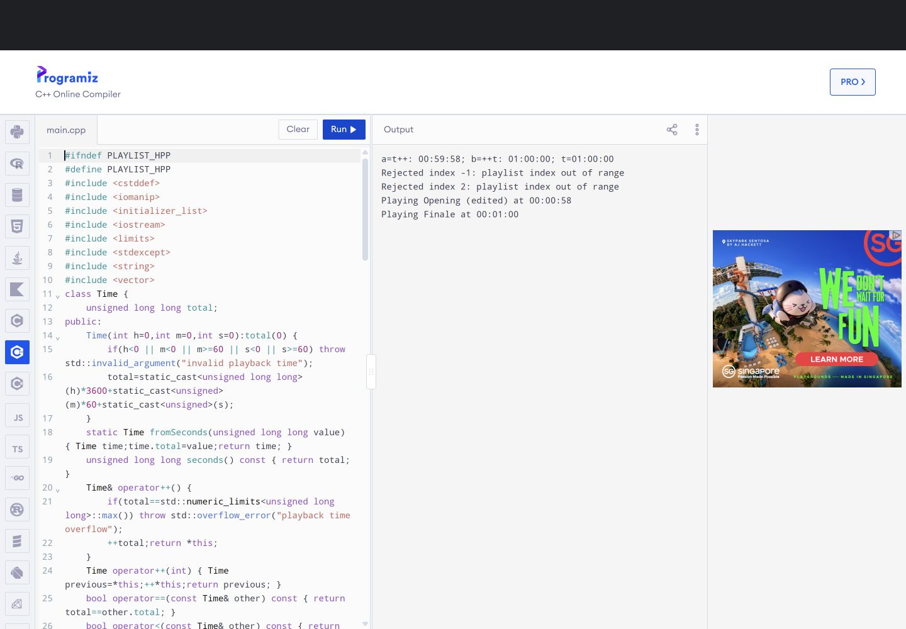
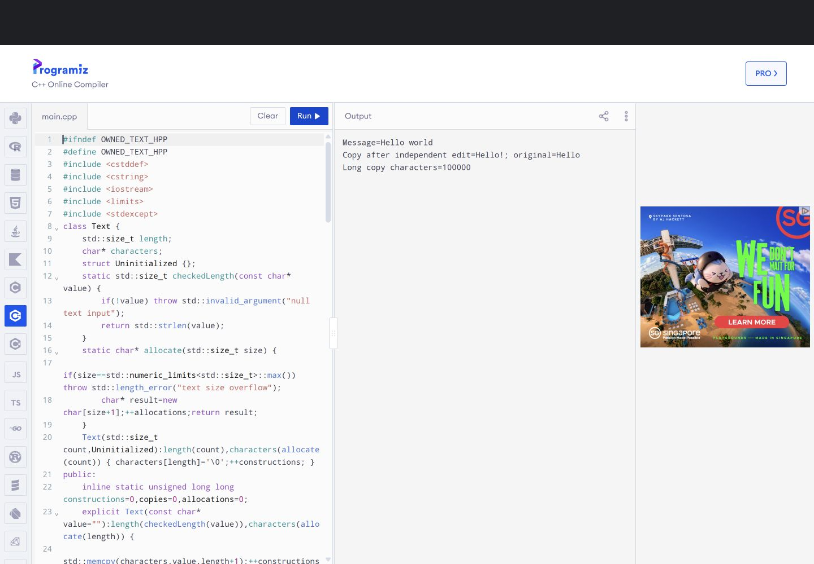
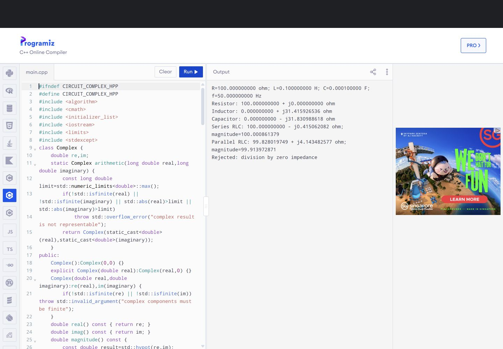

# DSA0110 - Assignment 3 (CO3)

Name: D Hoshea Paul

Register Number: 192471019

Slot: B

GitHub Repository: https://github.com/hosheapaul2006/DSA0110_SLOT-B-192471019-Assignment-3

Submission date: not specified in the assignment PDF.

## Scope, environment and evidence

The original 15-page Assignment 3 (CO3) PDF contains Q1-Q7, total 50 marks. All implementations and benchmarks use C++17. The required process is Design -> Implementation -> Analysis -> Evaluation. This report is supported by the complete sources, exact commands and unchanged raw evidence in the repository.

Local compiler: GCC 14.2.0,WinLibs MinGW-w64 x86_64 UCRT POSIX SEH. Normal flags: `-std=c++17 -Wall -Wextra -Wpedantic -O0`; benchmarks additionally compile separately at `-O2`. Actual local platform/CPU:

```text
Windows-11-10.0.26300-SP0
Architecture: AMD64
AMD Ryzen AI 5 340 w/ Radeon 840M
```

The local Windows compiler lacks ASan/LeakSanitizer runtime libraries. With user approval, memory experiments ran on GitHub-hosted Ubuntu 24.04 with actual GCC 13.3.0. These are remote Linux observations, distinct from local Windows and Programiz evidence. Actual sanitizer flags: `-std=c++17 -Wall -Wextra -Wpedantic -g -O1 -fsanitize=address -fno-omit-frame-pointer`, with `ASAN_OPTIONS=detect_leaks=1:halt_on_error=1:alloc_dealloc_mismatch=1`.

Recorded execution: 28 successfully compiled base programs; 11 additional self-contained browser builds; 39 successfully compiled source files total. 24 safe base programs ran locally and four unsafe base programs ran only under isolated sanitizers. Two sources deliberately fail compilation. There are 41 successful normal local build/run configurations, including optimization/elision variants, 838 recorded local check evaluations (503 base plus 335 repeated derived-build checks), 11 sanitizer cases, 15 Programiz program comparisons and 29 genuine screenshots. Check counts include repeated configurations, not 838 distinct input scenarios.

Console demonstrations show coursework output; --tests sends verification labels/counts to stderr only in local testing. Python files orchestrate builds/auditing/documents and do not implement assignment solutions. online.cpp/online_* are mechanically flattened source files made from the same headers and drivers, compiled locally before those exact bytes are pasted into Programiz. The supplied prediction/TODO programs retain their original structure.

### Prediction chronology

| Question | Pre-execution commit | Exact result |
|---|---|---|
| Q3 Logger |0aa0309 | Matched, including final space and no newline |
| Q5 Counter |a7c3793 | Matched 5 7 7 plus newline |

The original predictions are immutable. Windows CRLF is decoded as LF for character comparisons; no other whitespace is discarded. Programiz result-pane text is checked separately against all expected stdout characters, allowing only its trailing UI blank space/success banner. Q7's hand-derived scalar reference/design was also saved before the custom Complex implementation.

### Submission scope

The existing repository name is preserved. The PDF convention DSA01-192471019-Assignment3 differs from it and requires faculty acceptance. The PDF date field is blank; no deadline/submission date has been invented. The user will submit Classroom personally. The PDF also requires individual student execution: automated/browser runs establish the recorded executions, not the student's personal completion of that requirement.

# Q1 - Constructors and Constructor Overloading

## Problem context and objective

Library Book Records: construct empty, title-only donated and full records, enforce valid copy counts and investigate constructor behaviour. PDF pages2-3;6 marks.

## Design and algorithm

Book stores a 128-byte title array, a 96-byte author array and an int copy count. Both character arrays include space for a null terminator. Every constructor has a member initializer list. The default constructor delegates to the full constructor with empty fields and zero copies. The explicit title-only constructor delegates with author "Donated" and one copy. The full constructor validates count >=0, rejects overlong text, then copies validated characters into its owned arrays. Throwing prevents a successfully constructed invalid object; no silent truncation occurs.

Pseudocode: initialize fixed fields; reject negative copies; reject title length>=128 or author length>=96; copy each field and terminate it. The independent full implementation validates once, so every delegating path shares the invariant.

## Constructor experiments

The missing-default source declares Book(int) but no Book(), so Book records[2] requires an unavailable default constructor and fails. A compiler supplies an implicit default constructor only when no user-declared constructor prevents its implicit declaration; it can still be deleted if member/base initialization is invalid. Declaring a parameterized constructor does not automatically provide a default constructor.

The reorder experiment safely initializes first=10 and second=20 with a deliberately reversed initializer list. GCC's actual -Wreorder warning and output10 20 are retained. There is no uninitialized read: members initialize in declaration order, regardless of list order. An initializer list directly initializes members; assignment in the body would first default-initialize/class-initialize them and then assign, and cannot replace required initialization of const/reference members.

The implicit experiment accepts print(3) by converting int to Book. The explicit version rejects the same implicit argument conversion. Explicit still permits direct construction Book(3). Mark single-argument constructors explicit when automatic conversions would be surprising or would hide units/meaning. The production title-only constructor is explicit.

## Three constructed object states

```text
empty:    [title=""                   ][author=""       ][copies=0]
donation: [title="Donated Algorithms" ][author="Donated"][copies=1]
complete: [title="C++ Foundations"    ][author="A. Reader"][copies=4]
Each object owns its fixed arrays; the objects share no character allocation.
```

## Alternative and evaluation

A single defaulted constructor could be `Book(string_view title="", string_view author="", int copies=0)`. Reuse the same full validation and storage logic. This creates a different title-only default (zero copies) unless an explicit policy selects one for donations. Delegating overloads make that donation policy clear at the call site. Neither design inherently requires more validation sites: both can validate in exactly one implementation.

For bounded fixed arrays, construction is O(1) time and O(1) auxiliary/per-object storage with respect to the number of books. Copying up to L supplied characters is O(L) if field capacity is treated as a variable; L is bounded here. The PDF's std::string alternative is not generally O(1) in unbounded title length: storing a string copy costs O(L) time/space. sizeof(Book) is measured in the actual local output, not assumed to be a language-wide ABI constant. Fixed storage gives predictable size but rejects longer metadata; a real library might prefer std::string.


## Relevant C++17 implementation

### Task01/book.hpp

```cpp
#ifndef LIBRARY_BOOK_HPP
#define LIBRARY_BOOK_HPP
#include <array>
#include <cstddef>
#include <cstring>
#include <iostream>
#include <stdexcept>
#include <string_view>
class Book {
    std::array<char,128> title{};
    std::array<char,96> author{};
    int copies;
    template<std::size_t N>
    static void store(std::array<char,N>& destination,std::string_view value) {
        if(value.size()>=N) throw std::length_error("book text exceeds fixed capacity");
        if(!value.empty()) std::memcpy(destination.data(),value.data(),value.size());
        destination[value.size()]='\0';
    }
public:
    Book():Book("","",0) {}
    explicit Book(std::string_view name):Book(name,"Donated",1) {}
    Book(std::string_view name,std::string_view writer,int count):title{},author{},copies(count) {
        if(count<0) throw std::invalid_argument("negative copy count");
        store(title,name);store(author,writer);
    }
    int count() const { return copies; }
    std::string_view name() const { return title.data(); }
    void print() const { std::cout << "Title=\"" << title.data() << "\" Author=\"" << author.data() << "\" Copies=" << copies << '\n'; }
};
#endif
```

### Task01/main.cpp

```cpp
#include "book.hpp"
#include "../tools/checks.hpp"
#include <string>
int main(int argc,char** argv) {
    Tests tests(argc,argv);
    Book empty,donation("Donated Algorithms"),complete("C++ Foundations","A. Reader",4);
    empty.print();donation.print();complete.print();
    tests.check(empty.count()==0 && empty.name().empty(),"default empty record");
    tests.check(donation.count()==1 && donation.name()=="Donated Algorithms","title-only donation");
    tests.check(complete.count()==4 && complete.name()=="C++ Foundations","full constructor");
    Book records[2];tests.check(records[0].count()==0 && records[1].count()==0,"default array construction");
    bool invalid=false;try { Book bad("Invalid","Author",-1); } catch(const std::invalid_argument& e) { invalid=true;std::cout << "Rejected: " << e.what() << '\n'; }
    tests.check(invalid,"negative copies rejected");
    Book zero("Withdrawn","Author",0);tests.check(zero.count()==0,"zero copies valid");
    Book boundary(std::string(127,'T'),std::string(95,'A'),1);
    tests.check(boundary.name().size()==127,"maximum fixed text lengths");
    bool longTitle=false,longAuthor=false;
    try { Book tooLong(std::string(128,'T')); } catch(const std::length_error&) { longTitle=true; }
    try { Book tooLong("Title",std::string(96,'A'),1); } catch(const std::length_error&) { longAuthor=true; }
    tests.check(longTitle && longAuthor,"overlong fields rejected without truncation");
    std::cout << "Book object bytes=" << sizeof(Book) << '\n';
}
```

## Constructor experiments: actual compiler evidence

### Task01/constructor_experiments/missing_default.cpp

```cpp
struct Book { explicit Book(int) {} };
int main() { Book records[2]; (void)records; }
```

### Task01/outputs/constructor_experiments_missing_default_compiler.txt

```text
C:\Projects\SLOT B\DSA0110_SLOT-B-192471019-Assignment-3\Task01\constructor_experiments\missing_default.cpp: In function 'int main()':
C:\Projects\SLOT B\DSA0110_SLOT-B-192471019-Assignment-3\Task01\constructor_experiments\missing_default.cpp:2:28: error: no matching function for call to 'Book::Book()'
    2 | int main() { Book records[2]; (void)records; }
      |                            ^
C:\Projects\SLOT B\DSA0110_SLOT-B-192471019-Assignment-3\Task01\constructor_experiments\missing_default.cpp:1:24: note: candidate: 'Book::Book(int)'
    1 | struct Book { explicit Book(int) {} };
      |                        ^~~~
C:\Projects\SLOT B\DSA0110_SLOT-B-192471019-Assignment-3\Task01\constructor_experiments\missing_default.cpp:1:24: note:   candidate expects 1 argument, 0 provided
C:\Projects\SLOT B\DSA0110_SLOT-B-192471019-Assignment-3\Task01\constructor_experiments\missing_default.cpp:1:8: note: candidate: 'constexpr Book::Book(const Book&)'
    1 | struct Book { explicit Book(int) {} };
      |        ^~~~
C:\Projects\SLOT B\DSA0110_SLOT-B-192471019-Assignment-3\Task01\constructor_experiments\missing_default.cpp:1:8: note:   candidate expects 1 argument, 0 provided
C:\Projects\SLOT B\DSA0110_SLOT-B-192471019-Assignment-3\Task01\constructor_experiments\missing_default.cpp:1:8: note: candidate: 'constexpr Book::Book(Book&&)'
C:\Projects\SLOT B\DSA0110_SLOT-B-192471019-Assignment-3\Task01\constructor_experiments\missing_default.cpp:1:8: note:   candidate expects 1 argument, 0 provided
```

### Task01/constructor_experiments/reorder.cpp

```cpp
#include <iostream>
class Order {
    int first;
    int second;
public:
    Order():second(20),first(10) {} // Deliberately listed out of declaration order.
    void print() const { std::cout << first << ' ' << second << '\n'; }
};
int main() { Order value;value.print(); }
```

### Task01/outputs/constructor_experiments_reorder_compiler.txt

```text
C:\Projects\SLOT B\DSA0110_SLOT-B-192471019-Assignment-3\Task01\constructor_experiments\reorder.cpp: In constructor 'Order::Order()':
C:\Projects\SLOT B\DSA0110_SLOT-B-192471019-Assignment-3\Task01\constructor_experiments\reorder.cpp:4:9: warning: 'Order::second' will be initialized after [-Wreorder]
    4 |     int second;
      |         ^~~~~~
C:\Projects\SLOT B\DSA0110_SLOT-B-192471019-Assignment-3\Task01\constructor_experiments\reorder.cpp:3:9: warning:   'int Order::first' [-Wreorder]
    3 |     int first;
      |         ^~~~~
C:\Projects\SLOT B\DSA0110_SLOT-B-192471019-Assignment-3\Task01\constructor_experiments\reorder.cpp:6:5: warning:   when initialized here [-Wreorder]
    6 |     Order():second(20),first(10) {} // Deliberately listed out of declaration order.
      |     ^~~~~
```

### Task01/outputs/constructor_experiments_reorder_actual.txt

```text
10 20
```

### Task01/constructor_experiments/implicit.cpp

```cpp
#include <iostream>
struct Book { int copies; Book(int count):copies(count) {} };
void print(Book value) { std::cout << "Copies=" << value.copies << '\n'; }
int main() { print(3); }
```

### Task01/outputs/constructor_experiments_implicit_actual.txt

```text
Copies=3
```

### Task01/constructor_experiments/explicit_rejected.cpp

```cpp
struct Book { int copies; explicit Book(int count):copies(count) {} };
void accept(Book) {}
int main() { accept(3); }
```

### Task01/outputs/constructor_experiments_explicit_rejected_compiler.txt

```text
C:\Projects\SLOT B\DSA0110_SLOT-B-192471019-Assignment-3\Task01\constructor_experiments\explicit_rejected.cpp: In function 'int main()':
C:\Projects\SLOT B\DSA0110_SLOT-B-192471019-Assignment-3\Task01\constructor_experiments\explicit_rejected.cpp:3:21: error: could not convert '3' from 'int' to 'Book'
    3 | int main() { accept(3); }
      |                     ^
      |                     |
      |                     int
```

## Executed test cases

| ID | Scenario/input | Expected | Actual | Result |
|---|---|---|---|---|
| 1 | Default Book | Empty title,0 copies | C++ check and printed state match | PASS |
| 2 | Title-only donation | Donated Algorithms,1 copy | Check/printed state match | PASS |
| 3 | Full Book | C++ Foundations,A. Reader,4 | Check/printed state match | PASS |
| 4 | Array of2 Books | Both default to0 copies | Checked | PASS |
| 5 | Negative copies | invalid_argument; no valid object produced | Exception caught and checked | PASS |
| 6 | Zero copies | Accepted | Checked | PASS |
| 7 | Title127/author95 characters | Accepted without truncation | Checked | PASS |
| 8 | Title128/author96 characters | length_error | Both exceptions checked | PASS |
| 9 | No Book() and default array | No matching constructor error | Actual GCC diagnostic captured | PASS |
| 10 | Reversed initializer list | -Wreorder; declaration-order values10 20 | Warning and output observed | PASS |
| 11 | Nonexplicit int constructor | print(3) compiles,prints Copies=3 | Observed | PASS |
| 12 | Explicit int constructor | Implicit argument conversion rejected | Actual compiler error captured | PASS |

The negative compiler programs are not executable deliverables. All observations have matching files in outputs/. Programiz evidence is recorded separately after online execution.


## Actual console output

### Task01/outputs/main_actual.txt

```text
Title="" Author="" Copies=0
Title="Donated Algorithms" Author="Donated" Copies=1
Title="C++ Foundations" Author="A. Reader" Copies=4
Rejected: negative copy count
Book object bytes=228
```

## Genuine Programiz figures

Each figure is an actual Run result with source beside output. Additional middle/end views for the long primary source files are retained in screenshots/. These images supplement the readable code and explanations above. Full unchanged captures remain available in the repository.



# Q2 - Copy Constructors: Shallow and Deep Copies

## Problem context and objective

Hospital Prescription Records: diagnose a raw owning shallow copy, implement independent deep copying, complete the supplied program, observe copy counts and measure copying. PDF pages3-6;7 marks.

## Design and algorithms

Prescription owns n medicine strings in an array allocated by new[]. The independent implementation rejects negative counts and out-of-range indices. Zero medicines use a null pointer, which delete[] safely accepts. A helper duplicates the array, copies every string, and releases a partially copied replacement if a string allocation throws.

Copy construction initializes a new object with a new allocation. Copy assignment first checks identity (`this==&other`), builds a complete replacement, then releases the old allocation and commits the new pointer/count. This protects self-assignment and preserves the target if copying throws. The destructor uses delete[] exactly once for its own allocation. These are the Rule of Three: destructor, copy constructor and copy assignment must agree on the ownership policy.

Pseudocode: COPY: allocate n strings; copy indices0..n-1; clean up on failure. ASSIGN: if same object return self; duplicate source; delete old array; install replacement; return self. DESTROY: delete[] owned array.

## Memory diagrams

```text
Shallow copy (isolated unsafe demonstration)
 original [n=2, pointer ------+]
 copy     [n=2, pointer ------+----> allocation A [medicine0][medicine1]]
 Two owners both delete[] A. Mutations are shared; final deletion is invalid.

Deep copy (correct implementation)
 original [n=2, pointer ----------> allocation A [Paracetamol][ORS]]
 copy     [n=2, pointer ----------> allocation B [Paracetamol][ORS]]
 assigned [n=2, pointer ----------> allocation C [Paracetamol][ORS]]
 Each owner deletes its own array. Updating B does not change A or C.
```

A pointer member's compiler-generated copy copies only the address. It does not invent ownership or allocate a second array. For string arrays, the second destructor can first read freed array/string metadata, so ASan may diagnose heap-use-after-free before it reaches the eventual second delete. Both indicate broken shared ownership. shallow_copy.cpp is compiled locally but executed only in the isolated sanitizer job. without_copy_constructor.cpp removes only the copy constructor from the completed supplied program, retaining its other code, for the requested negative experiment.

## Supplied TODO preservation

complete_code.cpp fills only TODO1,TODO2,TODO3 of Reference/Q2_TODO_original.txt. It produces the exact required line: Ibuprofen ORS | Paracetamol Cetirizine | Paracetamol ORS. No validation or logging is inserted into the supplied main, constructor or accessors. Its accessor precondition is a valid index and its supplied constructor expects a nonnegative count. The independent class supplies defensive validation without altering that exercise. Correct and negative sanitizer outputs are recorded separately; local normal compilation alone does not prove memory safety.

## Copy counts and measurement

The independent copy constructor counts successful copies and can print a message. Passing an existing lvalue by value makes one real copy in the executed test; passing it by const reference makes none. Typical copy-construction contexts are initialization from another object, a by-value parameter and returning an object by value. Return-value optimization and C++17 guaranteed prvalue elision mean the last case does not always invoke a copy constructor. Assignment to an already constructed object calls assignment instead.

The benchmark copies10,1000,100000 medicines with10000,200,5 repetitions respectively in each of five trials. Every string length is observed in a checksum. Allocation, copying, traversal and destruction are timed together, so dividing by repetitions estimates a complete copy lifetime, not isolated allocation latency. The input and checksum expectations are identical across optimization levels. See outputs/benchmark_O0_actual.txt and benchmark_O2_actual.txt for actual times; no improvement is inferred from Big-O alone.

## Alternatives and evaluation

With n medicine names and total L characters, deep copying generally costs O(n+L) time/storage; with bounded-length names this is O(n), as in the assignment's element-count model. A shallow pointer copy is O(1) time and additional pointer storage, but is unsafe for two independent raw owners. Its apparent speed is not a valid ownership implementation.

`vector<string> medicines;` needs no custom destructor/copy constructor/assignment. Its value copy owns independent strings and costs O(n+L), with O(n+L) additional storage. This is the Rule of Zero. The main program verifies a vector copy's independence. Compiler-generated copies suffice for value members such as string/vector or non-owning pointers with a valid lifetime policy; they do not suffice for an independently owning raw pointer. Prefer vector for application code. Implementing the raw owner teaches resource lifetime and exception-safe copying.


## Relevant C++17 implementation

### Task02/prescription.hpp

```cpp
#ifndef PRESCRIPTION_HPP
#define PRESCRIPTION_HPP
#include <iostream>
#include <stdexcept>
#include <string>
class Prescription {
    int n;
    std::string* medicines;
    static int checkedCount(int count) {
        if(count<0) throw std::invalid_argument("negative medicine count");
        return count;
    }
    static std::string* duplicate(const std::string* source,int count) {
        if(count==0) return nullptr;
        std::string* result=new std::string[count];
        try { for(int i=0;i<count;++i) result[i]=source[i]; }
        catch(...) { delete[] result;throw; }
        return result;
    }
    void checkIndex(int i) const { if(i<0 || i>=n) throw std::out_of_range("medicine index"); }
public:
    inline static unsigned long long copyConstructions=0;
    inline static bool traceCopies=false;
    explicit Prescription(int count):n(checkedCount(count)),medicines(n?new std::string[n]:nullptr) {}
    Prescription(const Prescription& other):n(other.n),medicines(duplicate(other.medicines,other.n)) {
        ++copyConstructions;
        if(traceCopies) std::cout << "Copy constructor: " << n << " medicines\n";
    }
    Prescription& operator=(const Prescription& other) {
        if(this==&other) return *this;
        std::string* replacement=duplicate(other.medicines,other.n);
        delete[] medicines;medicines=replacement;n=other.n;
        return *this;
    }
    ~Prescription() { delete[] medicines; }
    int size() const { return n; }
    void set(int i,const std::string& medicine) { checkIndex(i);medicines[i]=medicine; }
    const std::string& get(int i) const { checkIndex(i);return medicines[i]; }
};
#endif
```

### Task02/main.cpp

```cpp
#include "prescription.hpp"
#include "../tools/checks.hpp"
#include <vector>
std::string byValue(Prescription value) { value.set(0,"Temporary");return value.get(0); }
const std::string& byConstReference(const Prescription& value) { return value.get(0); }
int main(int argc,char** argv) {
    Tests tests(argc,argv);
    Prescription p(2);p.set(0,"Paracetamol");p.set(1,"ORS");
    Prescription q=p;q.set(1,"Cetirizine");
    Prescription r(1);r=p;p.set(0,"Ibuprofen");
    std::cout << p.get(0) << ' ' << p.get(1) << " | " << q.get(0) << ' ' << q.get(1)
              << " | " << r.get(0) << ' ' << r.get(1) << '\n';
    tests.check(p.get(0)=="Ibuprofen" && q.get(0)=="Paracetamol" && r.get(0)=="Paracetamol","copies own independent medicine arrays");
    tests.check(q.get(1)=="Cetirizine" && p.get(1)=="ORS","copied medicine changes do not alter original");
    const auto before=Prescription::copyConstructions;
    Prescription::traceCopies=true;
    tests.check(byValue(p)=="Temporary" && p.get(0)=="Ibuprofen","pass-by-value modification is independent");
    const auto afterValue=Prescription::copyConstructions;
    tests.check(byConstReference(p)=="Ibuprofen","const-reference reads original");
    const auto afterReference=Prescription::copyConstructions;
    Prescription::traceCopies=false;
    tests.check(afterValue-before==1 && afterReference-afterValue==0,"value makes one copy; const reference makes none");
    std::cout << "Pass-by-value copies=" << afterValue-before << "; const-reference copies=" << afterReference-afterValue << '\n';
    p=p;tests.check(p.get(0)=="Ibuprofen" && p.size()==2,"self-assignment preserves data");
    Prescription empty(0),emptyCopy(empty);r=empty;
    tests.check(emptyCopy.size()==0 && r.size()==0,"empty copy construction and assignment");
    bool negative=false,index=false;
    try { Prescription invalid(-1); } catch(const std::invalid_argument&) { negative=true; }
    try { empty.get(0); } catch(const std::out_of_range&) { index=true; }
    tests.check(negative && index,"negative count and empty index rejected");
    std::vector<std::string> automatic={"Paracetamol","ORS"};auto copied=automatic;copied[0]="Changed";
    tests.check(automatic[0]=="Paracetamol" && copied[0]=="Changed","vector Rule-of-Zero copy independence");
}
```

## Completed supplied TODO program

Only the requested TODO regions were replaced. Reference contains the original PDF-extracted source, and the preservation audit reconstructs the completed program from those replacements.

### Task02/complete_code.cpp

```cpp
#include <iostream> 
#include <string> 
 
class Prescription { 
    int n; 
    std::string* medicines;            // dynamically allocated array 
 
public: 
    explicit Prescription(int count) : n(count), medicines(new std::string[count]) {} 
 
    Prescription(const Prescription& other) : n(other.n), medicines(new std::string[other.n])
    {
        try { for (int i = 0; i < n; ++i) medicines[i] = other.medicines[i]; }
        catch (...) { delete[] medicines; throw; }
    }
 
    Prescription& operator=(const Prescription& other)
    {
        if (this == &other) return *this;
        std::string* replacement = new std::string[other.n];
        try { for (int i = 0; i < other.n; ++i) replacement[i] = other.medicines[i]; }
        catch (...) { delete[] replacement; throw; }
        delete[] medicines;
        medicines = replacement;
        n = other.n;
        return *this;
    }
 
    ~Prescription() 
    { 
        delete[] medicines;
    } 
 
    void set(int i, const std::string& m) { medicines[i] = m; } 
    std::string get(int i) const { return medicines[i]; } 
}; 
 
int main() 
{ 
    Prescription p(2); 
    p.set(0, "Paracetamol"); 
    p.set(1, "ORS"); 
    Prescription q = p;                // copy constructor 
    q.set(1, "Cetirizine"); 
    Prescription r(1); 
    r = p;                             // copy assignment 
    p.set(0, "Ibuprofen"); 
    std::cout << p.get(0) << ' ' << p.get(1) << " | " << q.get(0) << ' ' << q.get(1) 
              << " | " << r.get(0) << ' ' << r.get(1) << '\n'; 
}
```

Required expected output:

### Task02/outputs/complete_expected.txt

```text
Ibuprofen ORS | Paracetamol Cetirizine | Paracetamol ORS
```

Actual execution output:

### Task02/outputs/complete_code_actual.txt

```text
Ibuprofen ORS | Paracetamol Cetirizine | Paracetamol ORS
```

## Authentic sanitizer evidence

Source SHA256,compiler command,run command,ASAN_OPTIONS,exit code,UTC time and workflow URL accompany each raw log. PASS below means the expected observation occurred; a negative example remains intentionally defective.

| Source | Expected | Actual exit | Observation |
|---|---|---|---|
| Task02/main.cpp | No sanitizer findings | 0 | Exit 0, empty sanitizer stderr |
| Task02/deep_copy.cpp | No sanitizer findings | 0 | Exit 0, empty sanitizer stderr |
| Task02/complete_code.cpp | No sanitizer findings | 0 | Exit 0, empty sanitizer stderr |
| Task02/shallow_copy.cpp | Defect diagnostic | 1 | Expected real report observed |
| Task02/without_copy_constructor.cpp | Defect diagnostic | 1 | Expected real report observed |

Actual successful job: https://github.com/hosheapaul2006/DSA0110_SLOT-B-192471019-Assignment-3/actions/runs/42848528926

### Task02/shallow_copy.cpp

```cpp
// Isolated negative test. Execute ONLY under AddressSanitizer.
#include <iostream>
#include <string>
class Prescription {
    int n;
    std::string* medicines;
public:
    explicit Prescription(int count):n(count),medicines(new std::string[count]) {}
    ~Prescription() { delete[] medicines; }
    void set(int i,const std::string& value) { if(i>=0 && i<n) medicines[i]=value; }
    const std::string& get(int i) const { return medicines[i]; }
    const void* storage() const { return medicines; }
};
int main() {
    Prescription original(2);original.set(0,"Paracetamol");
    Prescription copy=original;copy.set(0,"Changed");
    std::cout << "Shared storage=" << std::boolalpha << (original.storage()==copy.storage())
              << "; original now=" << original.get(0) << std::endl;
    // Both destructors attempt to release the same owning array: expected ASan failure.
}
```

Raw diagnostic excerpt from Task02/outputs/sanitizer_shallow_copy_stderr.txt (full unchanged report retained in the repository):

```text
=================================================================
==2058==ERROR: AddressSanitizer: heap-use-after-free on address 0x507000000090 at pc 0x5604c47ddd15 bp 0x7fff42515450 sp 0x7fff42515440
READ of size 8 at 0x507000000090 thread T0
    #0 0x5604c47ddd14 in Prescription::~Prescription() /home/runner/work/DSA0110_SLOT-B-192471019-Assignment-3/DSA0110_SLOT-B-192471019-Assignment-3/Task02/shallow_copy.cpp:9
    #1 0x5604c47ddb08 in main /home/runner/work/DSA0110_SLOT-B-192471019-Assignment-3/DSA0110_SLOT-B-192471019-Assignment-3/Task02/shallow_copy.cpp:20
    #2 0x7fa105e2a1c9  (/lib/x86_64-linux-gnu/libc.so.6+0x2a1c9) (BuildId: a4a7992a8e66555c8141ab2a08a8465ff6e0ea65)
    #3 0x7fa105e2a28a in __libc_start_main (/lib/x86_64-linux-gnu/libc.so.6+0x2a28a) (BuildId: a4a7992a8e66555c8141ab2a08a8465ff6e0ea65)
    #4 0x5604c47dd404 in _start (/home/runner/work/DSA0110_SLOT-B-192471019-Assignment-3/DSA0110_SLOT-B-192471019-Assignment-3/build/sanitizer/Task02_shallow_copy+0x2404) (BuildId: ce5ebd4c8080bccbff0de56f41112952106dd30c)

0x507000000090 is located 0 bytes inside of 72-byte region [0x507000000090,0x5070000000d8)
freed by thread T0 here:
    #0 0x7fa1066ff738 in operator delete[](void*, unsigned long) ../../../../src/libsanitizer/asan/asan_new_delete.cpp:167
    #1 0x5604c47dddc2 in Prescription::~Prescription() /home/runner/work/DSA0110_SLOT-B-192471019-Assignment-3/DSA0110_SLOT-B-192471019-Assignment-3/Task02/shallow_copy.cpp:9
    #2 0x5604c47ddafc in main /home/runner/work/DSA0110_SLOT-B-192471019-Assignment-3/DSA0110_SLOT-B-192471019-Assignment-3/Task02/shallow_copy.cpp:20
    #3 0x7fa105e2a1c9  (/lib/x86_64-linux-gnu/libc.so.6+0x2a1c9) (BuildId: a4a7992a8e66555c8141ab2a08a8465ff6e0ea65)
    #4 0x7fa105e2a28a in __libc_start_main (/lib/x86_64-linux-gnu/libc.so.6+0x2a28a) (BuildId: a4a7992a8e66555c8141ab2a08a8465ff6e0ea65)
    #5 0x5604c47dd404 in _start (/home/runner/work/DSA0110_SLOT-B-192471019-Assignment-3/DSA0110_SLOT-B-192471019-Assignment-3/build/sanitizer/Task02_shallow_copy+0x2404) (BuildId: ce5ebd4c8080bccbff0de56f41112952106dd30c)

```

Actual diagnostic summary:

```text
SUMMARY: AddressSanitizer: heap-use-after-free /home/runner/work/DSA0110_SLOT-B-192471019-Assignment-3/DSA0110_SLOT-B-192471019-Assignment-3/Task02/shallow_copy.cpp:9 in Prescription::~Prescription()
```

Raw diagnostic excerpt from Task02/outputs/sanitizer_without_copy_constructor_stderr.txt (full unchanged report retained in the repository):

```text
=================================================================
==2065==ERROR: AddressSanitizer: heap-use-after-free on address 0x507000000090 at pc 0x56049d4d6a79 bp 0x7fff8e642840 sp 0x7fff8e642830
READ of size 8 at 0x507000000090 thread T0
    #0 0x56049d4d6a78 in Prescription::~Prescription() /home/runner/work/DSA0110_SLOT-B-192471019-Assignment-3/DSA0110_SLOT-B-192471019-Assignment-3/Task02/without_copy_constructor.cpp:26
    #1 0x56049d4d5e14 in main /home/runner/work/DSA0110_SLOT-B-192471019-Assignment-3/DSA0110_SLOT-B-192471019-Assignment-3/Task02/without_copy_constructor.cpp:45
    #2 0x7f686d82a1c9  (/lib/x86_64-linux-gnu/libc.so.6+0x2a1c9) (BuildId: a4a7992a8e66555c8141ab2a08a8465ff6e0ea65)
    #3 0x7f686d82a28a in __libc_start_main (/lib/x86_64-linux-gnu/libc.so.6+0x2a28a) (BuildId: a4a7992a8e66555c8141ab2a08a8465ff6e0ea65)
    #4 0x56049d4d5484 in _start (/home/runner/work/DSA0110_SLOT-B-192471019-Assignment-3/DSA0110_SLOT-B-192471019-Assignment-3/build/sanitizer/Task02_without_copy_constructor+0x2484) (BuildId: 1c1bf29df1c3e2eea6e2447b3583f22833b820c1)

0x507000000090 is located 0 bytes inside of 72-byte region [0x507000000090,0x5070000000d8)
freed by thread T0 here:
    #0 0x7f686e0ff738 in operator delete[](void*, unsigned long) ../../../../src/libsanitizer/asan/asan_new_delete.cpp:167
    #1 0x56049d4d6b26 in Prescription::~Prescription() /home/runner/work/DSA0110_SLOT-B-192471019-Assignment-3/DSA0110_SLOT-B-192471019-Assignment-3/Task02/without_copy_constructor.cpp:26
    #2 0x56049d4d5e08 in main /home/runner/work/DSA0110_SLOT-B-192471019-Assignment-3/DSA0110_SLOT-B-192471019-Assignment-3/Task02/without_copy_constructor.cpp:45
    #3 0x7f686d82a1c9  (/lib/x86_64-linux-gnu/libc.so.6+0x2a1c9) (BuildId: a4a7992a8e66555c8141ab2a08a8465ff6e0ea65)
    #4 0x7f686d82a28a in __libc_start_main (/lib/x86_64-linux-gnu/libc.so.6+0x2a28a) (BuildId: a4a7992a8e66555c8141ab2a08a8465ff6e0ea65)
    #5 0x56049d4d5484 in _start (/home/runner/work/DSA0110_SLOT-B-192471019-Assignment-3/DSA0110_SLOT-B-192471019-Assignment-3/build/sanitizer/Task02_without_copy_constructor+0x2484) (BuildId: 1c1bf29df1c3e2eea6e2447b3583f22833b820c1)

```

Actual diagnostic summary:

```text
SUMMARY: AddressSanitizer: heap-use-after-free /home/runner/work/DSA0110_SLOT-B-192471019-Assignment-3/DSA0110_SLOT-B-192471019-Assignment-3/Task02/without_copy_constructor.cpp:26 in Prescription::~Prescription()
```

## Actual measured benchmark trials and evaluation

Local Windows GCC14.2.0. Each configuration has five actual trials. Milliseconds include the operations described in explanation.md. Raw CSV and compiler/source/exit records are retained in outputs/.

## benchmark_O0

| Workload | Actual trials (ms) | Median (ms) |
|---|---|---|
| medicines=10, copies=10000 | 1.152800, 1.163500, 1.123700, 1.121800, 1.118400 | 1.123700 |
| medicines=1000, copies=200 | 1.790400, 3.141000, 1.764100, 1.761500, 1.762900 | 1.764100 |
| medicines=100000, copies=5 | 7.718300, 7.453800, 6.689700, 6.616200, 6.737700 | 6.737700 |

Median complete copy lifetime per copy (allocation, content traversal and destruction included):
- medicines=10, copies=10000: 0.112370 microseconds/copy.
- medicines=1000, copies=200: 8.820500 microseconds/copy.
- medicines=100000, copies=5: 1347.540000 microseconds/copy.

## benchmark_O2

| Workload | Actual trials (ms) | Median (ms) |
|---|---|---|
| medicines=10, copies=10000 | 0.651400, 0.524900, 0.523300, 0.518200, 0.520700 | 0.523300 |
| medicines=1000, copies=200 | 0.776700, 0.763900, 0.768200, 0.766600, 0.766000 | 0.766600 |
| medicines=100000, copies=5 | 5.158300, 4.617500, 4.671300, 4.591300, 4.552200 | 4.617500 |

Median complete copy lifetime per copy (allocation, content traversal and destruction included):
- medicines=10, copies=10000: 0.052330 microseconds/copy.
- medicines=1000, copies=200: 3.833000 microseconds/copy.
- medicines=100000, copies=5: 923.500000 microseconds/copy.

These are measured implementation/workload results. Loop/index work, allocation, copy elision, cache locality, guard costs and scheduler noise can affect them. Big-O and observed elapsed times are reported separately.


## Executed test cases

| ID | Scenario/input | Expected | Actual | Result |
|---|---|---|---|---|
| 1 | Copy construct and assign prescription; mutate p | q/r keep Paracetamol, p becomes Ibuprofen | Checked | PASS |
| 2 | Change q's second medicine | p keeps ORS | Checked | PASS |
| 3 | By-value parameter mutation | Temporary changes local copy only | Checked | PASS |
| 4 | Const-reference parameter | Reads Ibuprofen; no new copy | Checked | PASS |
| 5 | Constructor instrumentation | Value1,reference0 copies | Counts observed and checked | PASS |
| 6 | p=p | Data/count preserved | Checked | PASS |
| 7 | Empty copy/assignment | size0; valid destruction | Checked | PASS |
| 8 | Negative count and empty index | Exceptions | Caught and checked | PASS |
| 9 | vector<string> copy | Independent mutation | Checked | PASS |
| 10 | Deep-copy resized assignment and returned reference | Three independent values; assignment returns self | deep_copy.cpp checked | PASS |
| 11 | Supplied TODO | Exact expected line | Character comparison matched | PASS |
| 12 | Copy sizes10,1000,100000, five trials at both flags | Every copied length checksum agrees |30 actual trial checks passed | PASS |
| 13 | Correct raw owners under ASan/LSan | Exit0,no sanitizer findings | Seven relevant correct owners collectively exited0 without sanitizer stderr; see per-source logs | PASS |
| 14 | Shallow copy and removed-copy-constructor experiment | Real ASan use-after-free/double-delete diagnostic | Both negative variants produced actual heap-use-after-free reports | PASS |

Local outputs include actual stdout/stderr, source hashes, flags and exit codes. Sanitizer results are actual remote Ubuntu execution; the successful run URL and source hashes are retained.


## Actual console output

### Task02/outputs/main_actual.txt

```text
Ibuprofen ORS | Paracetamol Cetirizine | Paracetamol ORS
Copy constructor: 2 medicines
Pass-by-value copies=1; const-reference copies=0
```

## Genuine Programiz figures

Each figure is an actual Run result with source beside output. Additional middle/end views for the long primary source files are retained in screenshots/. These images supplement the readable code and explanations above. Full unchanged captures remain available in the repository.






# Q3 - Dynamic Constructors and Destructors

## Problem context and objective

Auditorium Seat Booking: allocate a dynamic two-dimensional map, book/cancel seats, summarize/release ownership on destruction and investigate object lifetimes/memory. PDF pages6-8;7 marks.

## Design, ownership and algorithm

Auditorium owns an array of row pointers and one char array per row. Constructor initialization validates nonnegative dimensions and checks the cell-count product before allocating. Pointer entries start as null; if any row allocation throws, the constructor catches the failure, deletes all previously allocated rows and the pointer array, then rethrows. A zero-row map uses nullptr and performs no allocation. Booking/cancellation check both indices, change only the requested state and update successful-operation statistics; duplicate operations return false.

The destructor prints its closing summary, deletes every row with delete[], then deletes the row-pointer array with delete[]. Copy construction and assignment are deleted, preventing two owners of the same seat map. No move/ownership transfer interface is offered. Pseudocode: validate; allocate R pointers; allocate/zero C chars per row; on book set an unbooked char; on cancel clear a booked char; on destruction delete each row and then the pointers. RAII means storage is released whenever the fully constructed object's lifetime ends, including stack unwinding. A raw heap object still needs its lifetime ended with delete; a destructor cannot clean an object whose owner never invokes it.

## Memory diagram and alternatives

```text
event [rows=2, seatsPerRow=3, seats --+]
                                   +--> row pointers [p0][p1]
                                                      |   |
                                            row0 [0][1][0] |
                                            row1 [0][0][1]<+
```

The row allocations are separate and not guaranteed adjacent. For R>0 there are R+1 new[] calls; requested character payload is R*C*sizeof(char), plus R*sizeof(char*) for row pointers. These requested byte counts exclude allocator bookkeeping, alignment, the object and its name. memory.cpp actually constructs and touches all cells of10x20,100x200,1000x2000 maps. Its process resident bytes come from the Windows working-set API (or /proc/self/status on Linux). That whole-process measurement includes executable/runtime/allocator memory and retained allocations; it is not the map payload and must not be substituted for it. A zero return would mean unavailable measurement, not zero process memory.

Alternative contiguous block pseudocode: allocate char[R*C]{}; access block[r*C+s]; delete[] block. It has one allocation for a nonempty map, no row-pointer array and predictable locality. vector<vector<char>>(R,vector<char>(C)) manages row lifetimes automatically and costs typically one outer allocation plus R nonempty row allocations, plus per-vector object/capacity metadata. Contiguous vector<char> combines automatic ownership and one block. All have O(1) indexed access and O(R*C) initialization/payload storage; row pointers/vector rows add O(R) metadata. The destructor releases O(R) allocations; initialization dominates O(R*C) when rows are nonempty. Prefer contiguous RAII storage in application code; manual rows satisfy the required exercise and demonstrate ownership.

## Lifetimes and diagnostic experiments

The main event constructs first and dies last. The nested event dies at block exit. The heap event dies exactly at explicit delete, not when its pointer variable goes out of scope. Constructor/destructor messages and closing counts are actual output. A destructor has a fixed no-argument special-member signature and cannot be overloaded by differing argument lists.

proper_delete.cpp releases a heap event. missing_delete.cpp intentionally loses a heap owner in a noinline function on a worker thread that is joined before exit, so completed-thread stack/register roots no longer retain the allocation. The first function-only attempt had no leak report; it is preserved and investigated in Reference/sanitizer_experiment_notes.md. The revised actual run diagnosed102 leaked bytes/four allocations. mismatched_delete.cpp deliberately pairs new[] with scalar delete; both GCC's warning and the sanitizer's actual mismatch diagnostic are retained separately. The unsafe programs are never normal online demonstrations. delete destroys/deallocates a single object; delete[] handles an array and must match the allocation form.

## Logger prediction

Prediction commit precedes the first execution. The exact output is `+A +B -B copyAc use -Ac +P -P end -A `, with one final space and no newline. B dies at its block end; passing lvalue a to use(Logger) constructs Ac and destroys that parameter at call completion. P is explicitly deleted; A dies on main exit. The program and original prediction remain unchanged, and the actual output is compared character by character.


## Relevant C++17 implementation

### Task03/auditorium.hpp

```cpp
#ifndef AUDITORIUM_HPP
#define AUDITORIUM_HPP
#include <cstddef>
#include <iostream>
#include <limits>
#include <stdexcept>
#include <string>
class Auditorium {
    std::string name;
    int rows;
    int seatsPerRow;
    char** seats;
    std::size_t occupied=0;
    unsigned long long bookings=0,cancellations=0;
    bool messages;
    static int dimension(int value) { if(value<0) throw std::invalid_argument("negative seat-map dimension");return value; }
    void index(int row,int seat) const {
        if(row<0 || row>=rows || seat<0 || seat>=seatsPerRow) throw std::out_of_range("seat outside map");
    }
public:
    Auditorium(const std::string& label,int r,int perRow,bool trace=true)
      :name(label),rows(dimension(r)),seatsPerRow(dimension(perRow)),seats(nullptr),messages(trace) {
        if(rows && static_cast<std::size_t>(seatsPerRow)>std::numeric_limits<std::size_t>::max()/static_cast<std::size_t>(rows))
            throw std::length_error("seat-map size overflow");
        if(rows) seats=new char*[rows]{};
        try { for(int i=0;i<rows;++i) seats[i]=new char[seatsPerRow]{}; }
        catch(...) { for(int i=0;i<rows;++i) delete[] seats[i];delete[] seats;throw; }
        if(messages) std::cout << "Open " << name << " (" << rows << 'x' << seatsPerRow << ")\n";
    }
    Auditorium(const Auditorium&)=delete;
    Auditorium& operator=(const Auditorium&)=delete;
    ~Auditorium() {
        if(messages) std::cout << "Close " << name << ": occupied=" << occupied << ", bookings=" << bookings << ", cancellations=" << cancellations << '\n';
        for(int i=0;i<rows;++i) delete[] seats[i];
        delete[] seats;
    }
    bool book(int row,int seat) { index(row,seat);if(seats[row][seat]) return false;seats[row][seat]=1;++occupied;++bookings;return true; }
    bool cancel(int row,int seat) { index(row,seat);if(!seats[row][seat]) return false;seats[row][seat]=0;--occupied;++cancellations;return true; }
    std::size_t booked() const { return occupied; }
    std::size_t payloadBytes() const { return static_cast<std::size_t>(rows)*static_cast<std::size_t>(seatsPerRow)*sizeof(char); }
    std::size_t pointerBytes() const { return static_cast<std::size_t>(rows)*sizeof(char*); }
    std::size_t allocations() const { return rows?static_cast<std::size_t>(rows)+1:0; }
};
#endif
```

### Task03/main.cpp

```cpp
#include "auditorium.hpp"
#include "../tools/checks.hpp"
#include <type_traits>
int main(int argc,char** argv) {
    Tests tests(argc,argv);
    Auditorium mainEvent("Main",2,3);
    tests.check(mainEvent.book(0,0) && mainEvent.book(1,2),"book valid seats at both boundaries");
    tests.check(!mainEvent.book(0,0),"duplicate booking rejected");
    tests.check(mainEvent.cancel(0,0) && !mainEvent.cancel(0,0),"cancellation and duplicate cancellation");
    tests.check(mainEvent.booked()==1,"booking statistics after cancellation");
    std::cout << "Current occupied seats=" << mainEvent.booked() << '\n';
    { Auditorium nested("Nested",1,2);tests.check(nested.book(0,1),"nested event booking"); }
    Auditorium* heap=new Auditorium("Heap",1,1);
    tests.check(heap->book(0,0),"heap event booking");delete heap;
    { Auditorium zero("Zero",0,5);tests.check(zero.booked()==0 && zero.allocations()==0 && zero.payloadBytes()==0,"zero rows allocate nothing");
      bool rejected=false;try { zero.book(0,0); } catch(const std::out_of_range&) { rejected=true; }
      tests.check(rejected,"booking a zero-row map rejected"); }
    bool negative=false,invalidSeat=false;
    try { Auditorium invalid("Invalid",-1,2); } catch(const std::invalid_argument&) { negative=true; }
    try { mainEvent.book(-1,0); } catch(const std::out_of_range&) { invalidSeat=true; }
    tests.check(negative && invalidSeat,"negative dimension and negative seat rejected");
    tests.check(!std::is_copy_constructible_v<Auditorium> && !std::is_copy_assignable_v<Auditorium>,"owning auditorium is noncopyable");
    std::cout << "Leaving main scope\n";
}
```

## Exact pre-execution prediction and observation

```text
+A +B -B copyAc use -Ac +P -P end -A 
```

There is exactly one trailing space after -A and NO newline in the actual
predicted byte stream. outputs/predicted_output.txt stores those exact bytes.

a constructs A; nested b constructs B and dies at the nested block end. use(a)
copy-constructs an independent Ac parameter, prints use, then destroys that
parameter. The heap P is created and explicitly deleted. main prints end and
then a is destroyed. Passing the named lvalue a requires this copy; C++17 prvalue
elision does not remove it. Record/commit this prediction before compiling or
executing the supplied Logger program, and never rewrite it afterward.


### Task03/predict_output.cpp

```cpp
#include <iostream> 
#include <string> 
 
struct Logger { 
    std::string n; 
    Logger(const std::string& s) : n(s) { std::cout << '+' << n << ' '; } 
    Logger(const Logger& o) : n(o.n + "c") { std::cout << "copy" << n << ' '; } 
    ~Logger() { std::cout << '-' << n << ' '; } 
}; 
 
void use(Logger) { std::cout << "use "; } 
 
int main() 
{ 
    Logger a("A"); 
    { 
        Logger b("B"); 
    } 
    use(a); 
    Logger* p = new Logger("P"); 
    delete p; 
    std::cout << "end "; 
}
```

Original predicted output (Q3 ends with a space and no newline):

### Task03/outputs/predicted_output.txt

```text
+A +B -B copyAc use -Ac +P -P end -A 
```

Actual output:

### Task03/outputs/predict_output_actual.txt

```text
+A +B -B copyAc use -Ac +P -P end -A 
```

## Memory measurement evidence

### Task03/memory.cpp

```cpp
#include "auditorium.hpp"
#include "../tools/checks.hpp"
#if defined(_WIN32)
#ifndef _WIN32_WINNT
#define _WIN32_WINNT 0x0601
#endif
#ifndef NOMINMAX
#define NOMINMAX
#endif
#include <windows.h>
#include <psapi.h>
std::size_t residentBytes() {
    PROCESS_MEMORY_COUNTERS counters{};
    if(!K32GetProcessMemoryInfo(GetCurrentProcess(),&counters,sizeof(counters))) return 0;
    return counters.WorkingSetSize;
}
#else
#include <fstream>
#include <string>
std::size_t residentBytes() {
    std::ifstream input("/proc/self/status");std::string key;
    while(input>>key) { if(key=="VmRSS:") { std::size_t kb=0;input>>kb;return kb*1024; }std::string rest;std::getline(input,rest); }
    return 0;
}
#endif
int main(int argc,char** argv) {
    Tests tests(argc,argv);
    std::cout << "rows,seats,payload_bytes,row_pointer_bytes,allocation_calls,process_resident_bytes\n";
    for(int rows:{10,100,1000}) {
        const int columns=rows*2;
        Auditorium event("Memory",rows,columns,false);
        // Touch all cells so the process measurement includes committed pages.
        for(int row=0;row<rows;++row) for(int seat=0;seat<columns;++seat) event.book(row,seat);
        tests.check(event.payloadBytes()==static_cast<std::size_t>(rows)*columns,"requested seat payload bytes");
        tests.check(event.pointerBytes()==static_cast<std::size_t>(rows)*sizeof(char*) && event.allocations()==static_cast<std::size_t>(rows)+1,"pointer storage and allocation count");
        tests.check(event.booked()==static_cast<std::size_t>(rows)*columns,"all allocated seat cells touched");
        std::cout << rows << ',' << columns << ',' << event.payloadBytes() << ',' << event.pointerBytes()
                  << ',' << event.allocations() << ',' << residentBytes() << '\n';
    }
}
```

### Task03/outputs/memory_actual.txt

```text
rows,seats,payload_bytes,row_pointer_bytes,allocation_calls,process_resident_bytes
10,20,200,80,11,5066752
100,200,20000,800,101,5087232
1000,2000,2000000,8000,1001,7294976
```

## Authentic sanitizer evidence

Source SHA256,compiler command,run command,ASAN_OPTIONS,exit code,UTC time and workflow URL accompany each raw log. PASS below means the expected observation occurred; a negative example remains intentionally defective.

| Source | Expected | Actual exit | Observation |
|---|---|---|---|
| Task03/main.cpp | No sanitizer findings | 0 | Exit 0, empty sanitizer stderr |
| Task03/destructor_experiments/proper_delete.cpp | No sanitizer findings | 0 | Exit 0, empty sanitizer stderr |
| Task03/destructor_experiments/missing_delete.cpp | Defect diagnostic | 1 | Expected real report observed |
| Task03/destructor_experiments/mismatched_delete.cpp | Defect diagnostic | 1 | Expected real report observed |

Actual successful job: https://github.com/hosheapaul2006/DSA0110_SLOT-B-192471019-Assignment-3/actions/runs/42848528926

Run1: commit57584a3, GitHub Actions run42847619277. Seven correct programs
exited0 with empty sanitizer stderr. Both Q2 shallow-copy variants and Q3's
new[]/delete mismatch produced the expected actual ASan error. The missing-delete
experiment exited0 without a leak report, so its expected-diagnostic check FAILED.
All original records/bytes are retained in Reference/sanitizer_attempt1/.

The absence of a leak diagnostic was not labelled proof of correct ownership:
the source clearly omitted delete. Leak detection conservatively treats pointers
found in live registers/stacks as roots. The revised isolated experiment creates
the leaked event in a worker thread and joins it before process exit, removing
that completed thread's stack/register roots. It still omits delete and does not
suppress errors or alter the correct owning class. The later real run determines
whether the expected diagnostic is actually observed; do not assume its result.

Run2: commite17e99c,GitHub Actions run42848528926 succeeded. All seven correct cases exited0 without sanitizer stderr. Four negative cases exited1 with their expected reports; the revised missing-delete test reported102 bytes in four allocations. These are observed outcomes. Conservative root retention is a plausible explanation of the first no-report result, not a proven diagnosis of its exact register/stack state.


### Task03/destructor_experiments/missing_delete.cpp

```cpp
// Isolated leak experiment; execute only under ASan/LeakSanitizer.
#include "../auditorium.hpp"
#include <thread>
#if defined(__GNUC__)
__attribute__((noinline))
#endif
void omitDelete() {
    Auditorium* event=new Auditorium("Leaked",2,3);
    event->book(0,0);
    std::cout << "Intentionally forgotten delete, occupied=" << event->booked() << '\n';
}
int main() {
    // LeakSanitizer scans live stacks/registers conservatively. Completing this
    // worker removes its stack/register roots before the process leak check.
    std::thread worker(omitDelete);
    worker.join();
}
```

Raw diagnostic excerpt from Task03/outputs/sanitizer_destructor_experiments_missing_delete_stderr.txt (full unchanged report retained in the repository):

```text

=================================================================
==2086==ERROR: LeakSanitizer: detected memory leaks

Direct leak of 80 byte(s) in 1 object(s) allocated from:
    #0 0x7f18164fe548 in operator new(unsigned long) ../../../../src/libsanitizer/asan/asan_new_delete.cpp:95
    #1 0x55addbf2b69a in omitDelete() /home/runner/work/DSA0110_SLOT-B-192471019-Assignment-3/DSA0110_SLOT-B-192471019-Assignment-3/Task03/destructor_experiments/missing_delete.cpp:8
    #2 0x55addbf2c9b4 in void std::__invoke_impl<void, void (*)()>(std::__invoke_other, void (*&&)()) /usr/include/c++/13/bits/invoke.h:61
    #3 0x55addbf2c9b4 in std::__invoke_result<void (*)()>::type std::__invoke<void (*)()>(void (*&&)()) /usr/include/c++/13/bits/invoke.h:96
    #4 0x55addbf2c9b4 in void std::thread::_Invoker<std::tuple<void (*)()> >::_M_invoke<0ul>(std::_Index_tuple<0ul>) /usr/include/c++/13/bits/std_thread.h:292
    #5 0x55addbf2c9b4 in std::thread::_Invoker<std::tuple<void (*)()> >::operator()() /usr/include/c++/13/bits/std_thread.h:299
    #6 0x55addbf2c9b4 in std::thread::_State_impl<std::thread::_Invoker<std::tuple<void (*)()> > >::_M_run() /usr/include/c++/13/bits/std_thread.h:244
    #7 0x7f18160ecdb3  (/lib/x86_64-linux-gnu/libstdc++.so.6+0xecdb3) (BuildId: 753c6c8608b61d4e67be8f0c890e03e0aa046b8b)
    #8 0x7f181645ea41 in asan_thread_start ../../../../src/libsanitizer/asan/asan_interceptors.cpp:234
    #9 0x7f1815c9cb83  (/lib/x86_64-linux-gnu/libc.so.6+0x9cb83) (BuildId: a4a7992a8e66555c8141ab2a08a8465ff6e0ea65)

Indirect leak of 16 byte(s) in 1 object(s) allocated from:
    #0 0x7f18164fe6c8 in operator new[](unsigned long) ../../../../src/libsanitizer/asan/asan_new_delete.cpp:98
```

Actual diagnostic summary:

```text
SUMMARY: AddressSanitizer: 102 byte(s) leaked in 4 allocation(s).
```

### Task03/destructor_experiments/mismatched_delete.cpp

```cpp
// Isolated allocator/deallocator mismatch; execute only under ASan.
#include <iostream>
int main() { char* data=new char[32]{};data[0]='X';std::cout << data[0] << std::endl;delete data; }
```

Raw diagnostic excerpt from Task03/outputs/sanitizer_destructor_experiments_mismatched_delete_stderr.txt (full unchanged report retained in the repository):

```text
=================================================================
==2094==ERROR: AddressSanitizer: alloc-dealloc-mismatch (operator new [] vs operator delete) on 0x503000000040
    #0 0x7f68c84ff5e8 in operator delete(void*, unsigned long) ../../../../src/libsanitizer/asan/asan_new_delete.cpp:164
    #1 0x5579a40bf282 in main /home/runner/work/DSA0110_SLOT-B-192471019-Assignment-3/DSA0110_SLOT-B-192471019-Assignment-3/Task03/destructor_experiments/mismatched_delete.cpp:3
    #2 0x7f68c7c2a1c9  (/lib/x86_64-linux-gnu/libc.so.6+0x2a1c9) (BuildId: a4a7992a8e66555c8141ab2a08a8465ff6e0ea65)
    #3 0x7f68c7c2a28a in __libc_start_main (/lib/x86_64-linux-gnu/libc.so.6+0x2a28a) (BuildId: a4a7992a8e66555c8141ab2a08a8465ff6e0ea65)
    #4 0x5579a40bf144 in _start (/home/runner/work/DSA0110_SLOT-B-192471019-Assignment-3/DSA0110_SLOT-B-192471019-Assignment-3/build/sanitizer/Task03_destructor_experiments_mismatched_delete+0x1144) (BuildId: 448a5ea31f4d703cef7e433384b6d95785b53c44)

0x503000000040 is located 0 bytes inside of 32-byte region [0x503000000040,0x503000000060)
allocated by thread T0 here:
    #0 0x7f68c84fe6c8 in operator new[](unsigned long) ../../../../src/libsanitizer/asan/asan_new_delete.cpp:98
    #1 0x5579a40bf21f in main /home/runner/work/DSA0110_SLOT-B-192471019-Assignment-3/DSA0110_SLOT-B-192471019-Assignment-3/Task03/destructor_experiments/mismatched_delete.cpp:3
    #2 0x7f68c7c2a1c9  (/lib/x86_64-linux-gnu/libc.so.6+0x2a1c9) (BuildId: a4a7992a8e66555c8141ab2a08a8465ff6e0ea65)
    #3 0x7f68c7c2a28a in __libc_start_main (/lib/x86_64-linux-gnu/libc.so.6+0x2a28a) (BuildId: a4a7992a8e66555c8141ab2a08a8465ff6e0ea65)
    #4 0x5579a40bf144 in _start (/home/runner/work/DSA0110_SLOT-B-192471019-Assignment-3/DSA0110_SLOT-B-192471019-Assignment-3/build/sanitizer/Task03_destructor_experiments_mismatched_delete+0x1144) (BuildId: 448a5ea31f4d703cef7e433384b6d95785b53c44)

SUMMARY: AddressSanitizer: alloc-dealloc-mismatch ../../../../src/libsanitizer/asan/asan_new_delete.cpp:164 in operator delete(void*, unsigned long)
==2094==HINT: if you don't care about these errors you may set ASAN_OPTIONS=alloc_dealloc_mismatch=0
```

Actual diagnostic summary:

```text
SUMMARY: AddressSanitizer: alloc-dealloc-mismatch ../../../../src/libsanitizer/asan/asan_new_delete.cpp:164 in operator delete(void*, unsigned long)
```

## Executed test cases

| ID | Scenario/input | Expected | Actual | Result |
|---|---|---|---|---|
| 1 | Book first/last valid seat | Both succeed | Checked | PASS |
| 2 | Duplicate booking | false,statistics unchanged | Checked | PASS |
| 3 | Cancel then repeat cancellation | true then false | Checked | PASS |
| 4 | Remaining occupied count |1 | Checked | PASS |
| 5 | Nested and heap events | Booking succeeds; each closing message at correct lifetime end | Checked and output retained | PASS |
| 6 | Zero rows | No allocations,zero occupancy; booking throws | Checked | PASS |
| 7 | Negative dimensions/indices | Exceptions | Checked | PASS |
| 8 | Copy traits | Copy construction/assignment disabled | Checked | PASS |
| 9 | Logger | Exact precommitted output including final space/no newline | Matched | PASS |
| 10 | Three required seat-map sizes | Actual requested payload,pointer bytes and allocation counts; all cells touched | memory_actual.txt; payloads200/20000/2000000 bytes plus80/800/8000 pointer bytes | PASS |
| 11 | Proper heap delete | Open/close messages | Executed locally and clean under Ubuntu ASan/LSan | PASS |
| 12 | Missing delete and new[]/delete mismatch | Actual leak/mismatch sanitizer reports | Actual102-byte/four-allocation leak and alloc-dealloc-mismatch reports | PASS |

Process resident memory is measured separately from requested allocation bytes. Sanitizer statuses reflect the actual successful remote experiment; the first no-report leak attempt is preserved separately.


## Actual console output

### Task03/outputs/main_actual.txt

```text
Open Main (2x3)
Current occupied seats=1
Open Nested (1x2)
Close Nested: occupied=1, bookings=1, cancellations=0
Open Heap (1x1)
Close Heap: occupied=1, bookings=1, cancellations=0
Open Zero (0x5)
Close Zero: occupied=0, bookings=0, cancellations=0
Leaving main scope
Close Main: occupied=1, bookings=2, cancellations=1
```

## Genuine Programiz figures

Each figure is an actual Run result with source beside output. Additional middle/end views for the long primary source files are retained in screenshots/. These images supplement the readable code and explanations above. Full unchanged captures remain available in the repository.







# Q4 - Arithmetic and Stream Operator Overloading

## Problem context and objective

Billing Counter: represent Money in integer paise, overload arithmetic/comparison/streams, investigate precision and complete the supplied operators. PDF pages8-10;7 marks.

## Design, validation and algorithm

Money owns one signed long long paise value. Its explicit constructor interprets rupees*100+fraction arithmetically; fromPaise names an already scaled amount. Negative balances are permitted and print as Rs -0.25. The full implementation checks signed addition, subtraction and rupee scaling before arithmetic, throwing overflow_error without partially updating an accumulator. Even LLONG_MIN formats without calling abs on an unrepresentable positive magnitude: unsigned modular conversion obtains the magnitude safely.

Arithmetic pseudocode: reject overflow using limits and sign-aware comparisons; create a new value for + or -; for += assign the checked sum and return *this. Bill calculation is `first+second-discount`. Without operators the full expression would be subtract(add(first,second),discount). The named addition add(first,second) is implemented and checked against the operator result; a subtract wrapper would analogously delegate to the same checked arithmetic. Integer values represent every paise exactly within the signed64-bit range; this is bounded precision, not unlimited arithmetic.

Input accepts a signed decimal token such as -12.30,12,12.3, with one or two fractional digits if a decimal point is present. It rejects malformed tokens, extra fractional digits and values outside the signed paise range. It accumulates unsigned digits with overflow checks, then commits the result only on complete success. Failure sets failbit and leaves the target unchanged. The caller can clear the stream and decide how to report an error. Output includes Rs and exactly two fractional digits; stream flags/fill are restored. Input intentionally expects a bare amount, not the output's Rs prefix.

## Operator choices and translation

Nonmember friends + and - treat both operands symmetrically. Comparisons are const members. += is a member because it mutates its left operand and returns Money& for chaining. + returns a new Money because neither operand should change. `a+b` calls operator+(a,b) for this friend implementation; the supplied TODO deliberately uses a.operator+(b), as required. Stream insertion must support an ostream on the left, so it is a nonmember; it returns ostream& for chaining. Friendship allows direct access to representation, though public observers could implement output without friendship.

The primary constructor is explicit to keep units clear, so bare 100 is not silently converted in either operand position. If a nonexplicit Money(long long rupees) conversion is deliberately offered, a nonmember friend operator+(Money,Money) can convert either operand and support both100+m and m+100. A member operator+(Money) supports m+100 but cannot make an ordinary integer left operand perform member lookup on Money. Named functions can express the same policy without operator syntax. All arithmetic forms have O(1) time/auxiliary storage. Money*Money has currency-squared units and is intentionally omitted; a separately designed scalar multiplier could make sense with a documented rounding policy.

## Supplied TODO and limits

complete_code.cpp fills only the two TODO regions from Reference/Q4_TODO_original.txt and prints exactly Rs200.00 then true. It also formats negative values safely in its output operator. The supplied constructor's rupees*100+p and supplied-style + require representable arithmetic; the exercise's fixed positive values satisfy this. Its unchanged constructor is not advertised as a general overflow-safe API. The independent Money class implements those additional guards and boundary tests. A separate carry test checks75+50 paise=125.

## Million-addition experiment

benchmark.cpp generates1024 bounded paise values and equivalent doubles, then adds1000000 entries in the same cyclic order. An independent block-sum formula supplies the exact integer expectation. Five alternating-order trials are run under -O0 and -O2. The checksum is observable; IO and setup are outside timing. The hot loops use raw long long paise and double rupees to isolate representation arithmetic, not to imply that checked Money operators have no guard cost. The integer sum is exact; double output/error is printed with17 significant digits against the corresponding rounded double representation of the exact sum. Actual numeric results and timing medians are retained in outputs and benchmark_results.md. Repeated cache-friendly inputs and scheduler/optimizer effects limit generalization.

Parsing a token of length L takes O(L) time and O(L) token storage. Fixed-width arithmetic, comparison and formatting take O(1) time/space. Prefer integer paise for this billing task; floating point remains useful for scientific measurements but needs an explicit financial rounding policy.


## Relevant C++17 implementation

### Task04/money.hpp

```cpp
#ifndef MONEY_HPP
#define MONEY_HPP
#include <cctype>
#include <iomanip>
#include <iostream>
#include <limits>
#include <stdexcept>
#include <string>
class Money {
    long long paise;
    static long long addChecked(long long a,long long b) {
        if((b>0 && a>std::numeric_limits<long long>::max()-b) ||
           (b<0 && a<std::numeric_limits<long long>::min()-b)) throw std::overflow_error("money addition overflow");
        return a+b;
    }
    static long long subtractChecked(long long a,long long b) {
        if((b>0 && a<std::numeric_limits<long long>::min()+b) ||
           (b<0 && a>std::numeric_limits<long long>::max()+b)) throw std::overflow_error("money subtraction overflow");
        return a-b;
    }
public:
    explicit Money(long long rupees=0,int fraction=0):paise(0) {
        if(rupees>std::numeric_limits<long long>::max()/100 || rupees<std::numeric_limits<long long>::min()/100)
            throw std::overflow_error("rupees overflow");
        paise=addChecked(rupees*100,fraction);
    }
    static Money fromPaise(long long value) { Money result;result.paise=value;return result; }
    long long inPaise() const { return paise; }
    Money& operator+=(const Money& other) { paise=addChecked(paise,other.paise);return *this; }
    friend Money operator+(const Money& a,const Money& b) { return fromPaise(addChecked(a.paise,b.paise)); }
    friend Money operator-(const Money& a,const Money& b) { return fromPaise(subtractChecked(a.paise,b.paise)); }
    bool operator==(const Money& other) const { return paise==other.paise; }
    bool operator<(const Money& other) const { return paise<other.paise; }
    friend std::ostream& operator<<(std::ostream& out,const Money& value) {
        const auto flags=out.flags();const char fill=out.fill();
        const auto magnitude=value.paise<0?0ULL-static_cast<unsigned long long>(value.paise):static_cast<unsigned long long>(value.paise);
        out << std::dec << "Rs " << (value.paise<0?"-":"") << magnitude/100 << '.'
            << std::setfill('0') << std::setw(2) << magnitude%100;
        out.flags(flags);out.fill(fill);return out;
    }
    friend std::istream& operator>>(std::istream& in,Money& value) {
        std::string token;if(!(in>>token)) return in;
        std::size_t i=0;bool negative=false;
        if(token[i]=='-' || token[i]=='+') { negative=token[i]=='-';++i; }
        const auto maximum=static_cast<unsigned long long>(std::numeric_limits<long long>::max());
        const auto limit=maximum+(negative?1ULL:0ULL);
        unsigned long long magnitude=0;std::size_t digits=0;
        auto append=[&](unsigned digit) {
            if(magnitude>(limit-digit)/10) return false;
            magnitude=magnitude*10+digit;return true;
        };
        bool valid=true;
        while(i<token.size() && std::isdigit(static_cast<unsigned char>(token[i]))) {
            valid=valid && append(static_cast<unsigned>(token[i]-'0'));++i;++digits;
        }
        if(digits==0) valid=false;
        unsigned fractionalDigits=0;
        if(i<token.size() && token[i]=='.') {
            ++i;
            while(i<token.size() && std::isdigit(static_cast<unsigned char>(token[i]))) {
                if(fractionalDigits==2) valid=false;
                valid=valid && append(static_cast<unsigned>(token[i]-'0'));++i;++fractionalDigits;
            }
            if(fractionalDigits==0) valid=false;
        }
        while(fractionalDigits<2) { valid=valid && append(0);++fractionalDigits; }
        if(i!=token.size() || !valid) { in.setstate(std::ios::failbit);return in; }
        const long long result=negative?(magnitude==maximum+1?std::numeric_limits<long long>::min():-static_cast<long long>(magnitude))
                                       :static_cast<long long>(magnitude);
        value=fromPaise(result);return in;
    }
};
inline Money add(const Money& a,const Money& b) { return a+b; }
#endif
```

### Task04/main.cpp

```cpp
#include "money.hpp"
#include "../tools/checks.hpp"
#include <sstream>
int main(int argc,char** argv) {
    Tests tests(argc,argv);
    Money first(120,75),second(79,25),discount(20);
    Money bill=first+second-discount;
    std::cout << "Bill=" << bill << '\n';
    tests.check(bill.inPaise()==18000 && add(first,second)==Money(200),"operator and named addition agree");
    Money carry=Money(0,75)+Money(0,50);std::cout << "Carry=" << carry << '\n';
    tests.check(carry==Money(1,25),"paise carry into rupees");
    Money negative=Money(0,50)-Money(0,75);std::cout << "Negative=" << negative << '\n';
    tests.check(negative.inPaise()==-25 && negative<Money(0),"negative balances and comparison");
    Money accumulator(1);tests.check(&(accumulator+=Money(0,25))==&accumulator && accumulator==carry,"plus-equals returns updated self reference");
    std::ostringstream formatted;formatted<<Money::fromPaise(std::numeric_limits<long long>::min());
    tests.check(formatted.str()=="Rs -92233720368547758.08","minimum signed value formats without absolute-value overflow");
    Money read(99);std::istringstream valid("-12.3");valid>>read;
    tests.check(!valid.fail() && read.inPaise()==-1230,"signed decimal stream input");
    std::cout << "Read=" << read << '\n';
    for(const char* token:{"1.234","abc","12.","+","92233720368547758.08"}) {
        Money unchanged(7);std::istringstream bad(token);bad>>unchanged;
        tests.check(bad.fail() && unchanged==Money(7),"invalid input leaves target unchanged and sets failbit");
    }
    std::istringstream minimum("-92233720368547758.08");minimum>>read;
    tests.check(!minimum.fail() && read.inPaise()==std::numeric_limits<long long>::min(),"minimum signed input accepted");
    bool overflow=false,underflow=false;
    Money maximum=Money::fromPaise(std::numeric_limits<long long>::max());
    try { maximum+=Money::fromPaise(1); } catch(const std::overflow_error&) { overflow=true; }
    try { Money::fromPaise(std::numeric_limits<long long>::min())-Money::fromPaise(1); } catch(const std::overflow_error&) { underflow=true; }
    tests.check(overflow && underflow && maximum.inPaise()==std::numeric_limits<long long>::max(),"arithmetic overflow rejected without changing accumulator");
    std::ostringstream state;state<<std::setfill('*');state<<Money(2,5);state<<std::setw(3)<<1;
    tests.check(state.str()=="Rs 2.05**1","stream fill restored after Money output");
}
```

## Completed supplied TODO program

Only the requested TODO regions were replaced. Reference contains the original PDF-extracted source, and the preservation audit reconstructs the completed program from those replacements.

### Task04/complete_code.cpp

```cpp
#include <iomanip> 
#include <iostream> 
 
class Money { 
    long long paise; 
 
public: 
    Money(long long rupees = 0, int p = 0) : paise(rupees * 100 + p) {} 
 
    Money operator+(const Money& other) const
    {
        Money result;
        result.paise = paise + other.paise;
        return result;
    }
 
    bool operator==(const Money& other) const { return paise == other.paise; }
    friend std::ostream& operator<<(std::ostream& out, const Money& value)
    {
        const char previous = out.fill();
        const unsigned long long magnitude = value.paise < 0
            ? 0ULL - static_cast<unsigned long long>(value.paise)
            : static_cast<unsigned long long>(value.paise);
        out << "Rs " << (value.paise < 0 ? "-" : "") << magnitude / 100 << '.'
            << std::setfill('0') << std::setw(2) << magnitude % 100;
        out.fill(previous);
        return out;
    }
}; 
 
int main() 
{ 
    Money a(120, 75), b(79, 25); 
    Money c = a + b; 
    std::cout << c << '\n' << std::boolalpha << (c == Money(200)) << '\n'; 
}
```

Required expected output:

### Task04/outputs/complete_expected.txt

```text
Rs 200.00
true
```

Actual execution output:

### Task04/outputs/complete_code_actual.txt

```text
Rs 200.00
true
```

## Actual measured benchmark trials and evaluation

Local Windows GCC14.2.0. Each configuration has five actual trials. Milliseconds include the operations described in explanation.md. Raw CSV and compiler/source/exit records are retained in outputs/.

## benchmark_O0

| Workload | Actual trials (ms) | Median (ms) |
|---|---|---|
| integer_paise | 2.551100, 2.593500, 3.020700, 2.552100, 2.762800 | 2.593500 |
| double_rupees | 6.179900, 6.178500, 6.104300, 6.112900, 6.054600 | 6.112900 |

Numerical result: exact integer rupees=495213.32; double rupees=495213.31999996438; observed error=-3.5623088479042053e-08 rupees.

## benchmark_O2

| Workload | Actual trials (ms) | Median (ms) |
|---|---|---|
| integer_paise | 0.499100, 0.557500, 0.505700, 0.502700, 0.526000 | 0.505700 |
| double_rupees | 1.511000, 1.510900, 1.498200, 1.509800, 1.498100 | 1.509800 |

Numerical result: exact integer rupees=495213.32; double rupees=495213.31999996438; observed error=-3.5623088479042053e-08 rupees.

These are measured implementation/workload results. Loop/index work, allocation, copy elision, cache locality, guard costs and scheduler noise can affect them. Big-O and observed elapsed times are reported separately.


## Executed test cases

| ID | Scenario/input | Expected | Actual | Result |
|---|---|---|---|---|
| 1 |120.75+79.25-20 | Rs180.00; named add yields200 | Checked and printed | PASS |
| 2 |0.75+0.50 | Rs1.25 | Checked and printed | PASS |
| 3 |0.50-0.75 | Rs -0.25; less than zero | Checked | PASS |
| 4 | += | Updated value and reference to self | Checked | PASS |
| 5 | Minimum long long | Rs -92233720368547758.08 without abs overflow | Exact string checked | PASS |
| 6 | Input -12.3 | -1230 paise | Checked | PASS |
| 7 |1.234,abc,12.,+,positive overflow input | failbit; target remains Rs7 | Five cases checked | PASS |
| 8 | Minimum signed input | LLONG_MIN paise | Checked | PASS |
| 9 | Max+1 and min-1 | overflow_error; += target unchanged | Checked | PASS |
| 10 | Stream with custom fill | Rs2.05 then **1 | Exact string checked | PASS |
| 11 | Supplied TODO | Rs200.00 newline true newline | Exact characters matched | PASS |
| 12 | Million integer/double additions,five trials,both flags | Exact integer checksum; bounded observed floating error |20 actual checks | PASS |

Actual outputs, compiler records and check logs are in outputs/. Benchmark results are observations, not universal speed guarantees.


## Actual console output

### Task04/outputs/main_actual.txt

```text
Bill=Rs 180.00
Carry=Rs 1.25
Negative=Rs -0.25
Read=Rs -12.30
```

## Genuine Programiz figures

Each figure is an actual Run result with source beside output. Additional middle/end views for the long primary source files are retained in screenshots/. These images supplement the readable code and explanations above. Full unchanged captures remain available in the repository.




# Q5 - Increment, Comparison and Subscript Operators

## Problem context and objective

Music Playlist and Track Timer: implement prefix/postfix increments, comparisons, checked const/nonconst subscripts and a playback simulation; verify predictions and measured costs. PDF pages11-13;6 marks.

## Design and pseudocode

Time stores total seconds as an unsigned long long playback duration. Its constructor rejects negative fields and minute/second values outside0..59. Hours need not wrap at24 because this represents duration, not a day clock. Prefix checks the representable maximum, increments total and returns *this by reference. Postfix stores the old Time, calls prefix, then returns the old value. Formatting divides total into hours, minutes and seconds. Minute/hour rollover therefore requires no separate carry branches.

Playlist owns vector<string> tracks. Its signed index policy rejects i<0 or i>=size with out_of_range. Nonconst [] returns string& for editing; const [] returns const string& for reading without allowing mutation. at(i) explicitly delegates to the same checked access. unchecked(i) is a separate comparison interface with the precondition i<size, used only with valid benchmark indices. The independent simulation catches errors at the caller and prints a meaningful message rather than returning a fabricated track.

## Prefix, postfix and prediction

The unused int parameter distinguishes postfix operator++(int) from prefix operator++(). It does not specify how far to advance. Prefix returns the updated object reference; postfix must preserve the prior value when its value is observed, normally by returning a value copy. Copy elision and optimization can remove physical copying, especially when a postfix result is discarded. Thus the PDF's blanket suggestion that postfix is always slower is not a universal timing fact. ++i is a useful class-type default when the old value is unnecessary, but measurements decide whether it matters here.

For the supplied Counter, c=5; a=c++ stores5 and changes c to6; b=++c changes c to7 and copies7 into b. The exact precommitted output5 7 7 matched. The original prediction and source remain unchanged.

## Range policy and alternatives

The PDF proposes checked [] that prints an error directly. Printing alone cannot safely provide a valid reference for an invalid index. This design throws; the caller catches and reports it, so containers stay independent of UI/output choices and no dangling/fabricated fallback reference is used. at(i) communicates checked access explicitly and throws the same exception. An unchecked built-in/vector-style interface omits the guard but invalid access is undefined behaviour, so the unchecked benchmark never uses negative/size-equal indices.

All three access interfaces are O(1); reference return uses O(1) extra space. The signed guard logically checks both lower and upper bounds; the compiler may combine checks, so no exact machine instruction count is assumed. Playlist storage is O(n+L) for n strings and L total characters. Time increment/comparison is O(1) time/space. Printing a name takes its character length; it is outside access timing.

## Benchmarks and evaluation

The increment benchmark performs10000000 operations over1024 independent Time objects, indexed by a reproducible pre-generated4096-entry sequence. This prevents a simple one-counter loop from collapsing into a single final addition. Five trials at -O0 and -O2 compare discarded prefix/postfix results, plus observed-return variants normalized to the same old-value checksum. Every final timer is checked against independently counted visits; value-use checksums are verified outside timing. No per-iteration IO or volatile write is timed. Returned-value variants are additional workloads, not a claim that prefix/postfix return identical semantics.

The access benchmark performs10000000 accesses to the same1024 track strings through checked [], at and unchecked interfaces. It uses the same valid index stream, expected length checksum and five alternating-order trials at both flags. Setup, expectation calculation and printing are outside timing; access and reading string length are inside. at delegates to the same guard, so optimization may produce identical implementations. Raw trials and medians are in outputs and benchmark_results.md. Cache-friendly repeated inputs, compiler transformation and scheduler noise limit these results; no universal postfix/check-cost claim is made.


## Relevant C++17 implementation

### Task05/playlist.hpp

```cpp
#ifndef PLAYLIST_HPP
#define PLAYLIST_HPP
#include <cstddef>
#include <iomanip>
#include <initializer_list>
#include <iostream>
#include <limits>
#include <stdexcept>
#include <string>
#include <vector>
class Time {
    unsigned long long total;
public:
    Time(int h=0,int m=0,int s=0):total(0) {
        if(h<0 || m<0 || m>=60 || s<0 || s>=60) throw std::invalid_argument("invalid playback time");
        total=static_cast<unsigned long long>(h)*3600+static_cast<unsigned>(m)*60+static_cast<unsigned>(s);
    }
    static Time fromSeconds(unsigned long long value) { Time time;time.total=value;return time; }
    unsigned long long seconds() const { return total; }
    Time& operator++() {
        if(total==std::numeric_limits<unsigned long long>::max()) throw std::overflow_error("playback time overflow");
        ++total;return *this;
    }
    Time operator++(int) { Time previous=*this;++*this;return previous; }
    bool operator==(const Time& other) const { return total==other.total; }
    bool operator<(const Time& other) const { return total<other.total; }
    friend std::ostream& operator<<(std::ostream& out,const Time& value) {
        const char oldFill=out.fill();out<<std::setfill('0')<<std::setw(2)<<value.total/3600<<':'
            <<std::setw(2)<<value.total/60%60<<':'<<std::setw(2)<<value.total%60;
        out.fill(oldFill);return out;
    }
};
class Playlist {
    std::vector<std::string> tracks;
    std::size_t checked(std::ptrdiff_t index) const {
        if(index<0 || static_cast<std::size_t>(index)>=tracks.size()) throw std::out_of_range("playlist index out of range");
        return static_cast<std::size_t>(index);
    }
public:
    Playlist()=default;
    Playlist(std::initializer_list<std::string> values):tracks(values) {}
    std::size_t size() const { return tracks.size(); }
    void add(const std::string& title) { tracks.push_back(title); }
    std::string& operator[](std::ptrdiff_t index) { return tracks[checked(index)]; }
    const std::string& operator[](std::ptrdiff_t index) const { return tracks[checked(index)]; }
    const std::string& at(std::ptrdiff_t index) const { return (*this)[index]; }
    const std::string& unchecked(std::size_t index) const { return tracks[index]; }
};
#endif
```

### Task05/main.cpp

```cpp
#include "playlist.hpp"
#include "../tools/checks.hpp"
#include <sstream>
#include <type_traits>
int main(int argc,char** argv) {
    Tests tests(argc,argv);
    Time t(0,59,58);Time a=t++;Time b=++t;
    std::cout << "a=t++: " << a << "; b=++t: " << b << "; t=" << t << '\n';
    tests.check(a==Time(0,59,58) && b==Time(1,0,0) && t==b,"postfix old value and prefix updated value");
    tests.check(a<b && !(b<a) && b==t,"earlier later and identical timestamps");
    Time minute(0,0,59);++minute;tests.check(minute==Time(0,1,0),"minute rollover");
    std::ostringstream printed;printed<<b;tests.check(printed.str()=="01:00:00","hour rollover formatting");
    Playlist playlist{"Opening","Finale"};playlist[0]="Opening (edited)";
    const Playlist& readOnly=playlist;
    tests.check(readOnly[0]=="Opening (edited)" && readOnly.at(1)=="Finale","mutable and const subscript access");
    tests.check((std::is_same_v<decltype(readOnly[0]),const std::string&>),"const playlist returns const reference");
    for(std::ptrdiff_t index:{-1,2}) {
        bool rejected=false;try { (void)playlist[index]; } catch(const std::out_of_range& e) { rejected=true;std::cout<<"Rejected index "<<index<<": "<<e.what()<<'\n'; }
        tests.check(rejected,"negative or size-equal index rejected");
    }
    Playlist empty;bool emptyRejected=false;
    try { (void)empty[0]; } catch(const std::out_of_range&) { emptyRejected=true; }
    tests.check(empty.size()==0 && emptyRejected,"empty playlist handled without invalid access");
    bool invalidTime=false;try { Time invalid(-1,0,0); } catch(const std::invalid_argument&) { invalidTime=true; }
    tests.check(invalidTime,"negative playback time rejected");
    Time limit=Time::fromSeconds(std::numeric_limits<unsigned long long>::max());bool overflow=false;
    try { ++limit; } catch(const std::overflow_error&) { overflow=true; }
    tests.check(overflow && limit.seconds()==std::numeric_limits<unsigned long long>::max(),"timer overflow leaves state unchanged");
    Time play(0,0,58);
    for(std::ptrdiff_t i=0;i<static_cast<std::ptrdiff_t>(playlist.size());++i) { std::cout<<"Playing "<<readOnly[i]<<" at "<<play<<'\n';++play;++play; }
}
```

## Exact pre-execution prediction and observation

```text
5 7 7
```

The exact output has one newline. c starts at5; postfix saves5 into a and raises
c to6. Prefix raises c to7 and returns its updated reference, whose value is
copied into b. Thus a=5,b=7,c=7. The postfix dummy int distinguishes the two
operator signatures; it is not an increment amount.

Commit this file and outputs/predicted_output.txt before the first execution.
Do not modify the original prediction after seeing the result.


### Task05/predict_output.cpp

```cpp
#include <iostream> 
 
struct Counter { 
    int v; 
    Counter& operator++() { ++v; return *this; }                     // prefix 
    Counter operator++(int) { Counter old = *this; ++v; return old; } // postfix 
}; 
 
int main() 
{ 
    Counter c{5}; 
    Counter a = c++; 
    Counter b = ++c; 
    std::cout << a.v << ' ' << b.v << ' ' << c.v << '\n'; 
}
```

Original predicted output (Q3 ends with a space and no newline):

### Task05/outputs/predicted_output.txt

```text
5 7 7
```

Actual output:

### Task05/outputs/predict_output_actual.txt

```text
5 7 7
```

## Actual measured benchmark trials and evaluation

Local Windows GCC14.2.0. Each configuration has five actual trials. Milliseconds include the operations described in explanation.md. Raw CSV and compiler/source/exit records are retained in outputs/.

## access_benchmark_O0

| Workload | Actual trials (ms) | Median (ms) |
|---|---|---|
| checked_subscript | 65.416700, 66.126500, 66.114300, 65.989800, 65.822700 | 65.989800 |
| at | 74.438900, 74.993600, 74.787900, 74.217600, 73.998800 | 74.438900 |
| unchecked | 46.525700, 46.592800, 46.567900, 46.514800, 47.030900 | 46.567900 |

## access_benchmark_O2

| Workload | Actual trials (ms) | Median (ms) |
|---|---|---|
| checked_subscript | 2.695000, 2.682400, 2.702900, 2.680100, 2.667100 | 2.682400 |
| at | 2.662700, 2.654500, 2.663700, 2.643300, 2.687200 | 2.662700 |
| unchecked | 2.624600, 2.608800, 2.506900, 2.582300, 2.496500 | 2.582300 |

## benchmark_O0

| Workload | Actual trials (ms) | Median (ms) |
|---|---|---|
| prefix_discarded | 44.388400, 44.325400, 44.166300, 44.863000, 44.189000 | 44.325400 |
| postfix_discarded | 55.094700, 55.022300, 54.849000, 54.713900, 54.820300 | 54.849000 |
| prefix_value_used | 52.734400, 52.534500, 52.473300, 52.357800, 53.116300 | 52.534500 |
| postfix_value_used | 63.856700, 63.412100, 63.474800, 63.457300, 63.288300 | 63.457300 |

## benchmark_O2

| Workload | Actual trials (ms) | Median (ms) |
|---|---|---|
| prefix_discarded | 2.976000, 2.980200, 3.010400, 2.979100, 3.005800 | 2.980200 |
| postfix_discarded | 2.974500, 2.984800, 3.005300, 3.046900, 2.982600 | 2.984800 |
| prefix_value_used | 3.483700, 3.525600, 3.528400, 3.625500, 3.502800 | 3.525600 |
| postfix_value_used | 3.526900, 3.530000, 3.664600, 3.715900, 3.623500 | 3.623500 |

These are measured implementation/workload results. Loop/index work, allocation, copy elision, cache locality, guard costs and scheduler noise can affect them. Big-O and observed elapsed times are reported separately.


## Executed test cases

| ID | Scenario/input | Expected | Actual | Result |
|---|---|---|---|---|
| 1 | t=00:59:58,a=t++,b=++t | a00:59:58,b/t01:00:00 | Checked and printed | PASS |
| 2 | Identical/earlier/later comparisons | Correct equality and ordering | Checked | PASS |
| 3 |00:00:59 increment |00:01:00 | Checked | PASS |
| 4 | Hour boundary formatting |01:00:00 | Exact string matched | PASS |
| 5 | Edit playlist[0],read const playlist | Edited title visible; const reference returned | Values/type checked | PASS |
| 6 | playlist[-1],playlist[size] | out_of_range,caller prints message | Both caught and checked | PASS |
| 7 | Empty playlist index0 | out_of_range | Checked | PASS |
| 8 | Negative Time field | invalid_argument | Checked | PASS |
| 9 | Maximum total seconds increment | overflow_error,state unchanged | Checked | PASS |
| 10 | Supplied Counter | Exact5 7 7 newline | Precommitted prediction matched | PASS |
| 11 |10M increments,4 modes,5 trials,2 flags | Every timer and old-value checksum correct |40 trial checks | PASS |
| 12 |10M accesses,3 modes,5 trials,2 flags | Identical expected string-length checksum; valid indices only |30 trial checks | PASS |

Compiler/source/command records and actual local results are in outputs/. Programiz evidence is separate from flagged local benchmarks.


## Actual console output

### Task05/outputs/main_actual.txt

```text
a=t++: 00:59:58; b=++t: 01:00:00; t=01:00:00
Rejected index -1: playlist index out of range
Rejected index 2: playlist index out of range
Playing Opening (edited) at 00:00:58
Playing Finale at 00:01:00
```

## Genuine Programiz figures

Each figure is an actual Run result with source beside output. Additional middle/end views for the long primary source files are retained in screenshots/. These images supplement the readable code and explanations above. Full unchanged captures remain available in the repository.




# Q6 - Rules of Operator Overloading

## Problem context and objective

SMS Gateway Text: implement an owning character array, Rule-of-Three copying, operators, actual copy/elision investigation and std::string comparison. PDF pages13-14;7 marks.

## Design and algorithms

Text owns one dynamically allocated null-terminated character array and stores its length. Construction rejects nullptr, computes strlen and allocates length+1 bytes. The Rule-of-Three copy constructor allocates an independent buffer; assignment first protects self-assignment, allocates/copies a replacement and only then releases the old buffer. Destruction uses delete[]. No public mutable raw buffer is exposed. c_str() returns a const pointer whose lifetime still depends on the owner; assignment/destruction invalidates an old pointer.

Concatenation pseudocode: check length addition plus terminator for size_t overflow; allocate one exact-size result; copy left characters then right characters; write/retain the final null byte; return the result. The direct + does not mutate either operand. += allocates a replacement, copies both operands before deleting old storage and therefore supports a+=a. Equality first compares lengths, then characters; != negates equality. Output writes the stored C string. The implementation represents null-terminated text, not arbitrary byte strings with embedded null characters, and does not interpret Unicode code points.

## Copy instrumentation and elision

Static educational counters record successful allocations, constructions and copy constructors without printing inside hot loops. copy_experiment.cpp snapshots counters immediately around a+b+c, before comparison temporaries can affect the observations. The actual default local build observed0 copy constructors and2 result allocations. With -fno-elide-constructors it observed2 copies and4 allocations. The copy-plus-equals chain observed3 copies and5 allocations in both builds. These are captured compiler/run observations, not hardcoded expected language-wide counts. The content is checked independently in every variant. C++17 mandatory prvalue elision remains even when optional NRVO is disabled; named result/parameter returns can still affect copy counts. No move constructor is added to obscure the requested Rule-of-Three exercise.

The alternative policy `Text operator+(Text left,const Text& right) { left+=right;return left; }` is demonstrated as plusOnCopy(), avoiding two conflicting operator+ definitions in one class. Copying lvalue a into its parameter and returning a named parameter can create additional copies when no move operation is available. std::string handles ownership/copying automatically and generally has move and capacity-reuse opportunities.

## Character-copy and storage costs

For lengths n1,n2,n3, direct a+b+c copies n1+n2 characters into the first concatenation and n1+n2+n3 into the second, plus terminators:2n1+2n2+n3+O(1). The intermediate and final result overlap in lifetime during the second addition, so peak extra result storage is O((n1+n2)+(n1+n2+n3)). This simplifies to O(n1+n2+n3) Big-O time/storage. Optional extra copies add linear work and storage with the same asymptotic order. Copy-on-+= adds copies of incoming/returned values as observed; it need not change Big-O. A capacity-aware std::string may reuse the left temporary and change constants/allocation counts. Exact operator+ allocation strategy is implementation-dependent.

Copy construction/assignment is O(n), concat O(n1+n2), comparison worst-case O(n), printing O(n), owned storage O(n+1). Self-assignment returns immediately in O(1). Arithmetic overflow guards do not provide unlimited memory: a representable but unavailable allocation may still throw bad_alloc.

## Operator rules

The operators ::,.,.*,?:,sizeof cannot be overloaded; their language-defined parsing/member-selection/type-size roles are fixed. Operator precedence, associativity and arity cannot be changed. A user-defined overload requires at least one class/enum operand; it cannot redefine int+int. Assignment operator= must be a nonstatic member (in C++17) and controls mutation of its left object. Friends are useful for symmetric nonmember operations and streams when private access is justified, but friendship is not required if public observers suffice. Do not overload an operator with surprising meaning merely because syntax permits it.

## Measurement and recommendation

benchmark.cpp performs100000 a+b+c operations per mode, with input lengths256,128,64 and the same output448 characters. It compares custom direct+, copy-plus-equals and std::string across five alternating trials at both optimization levels. Setup, full-content sample checks and output are outside timing; each timed result's size/first/last characters feed an observable verified checksum. Allocation, concatenation and destruction are timed together. Custom allocation counts are captured before the outside-timing verification; std::string allocations are explicitly not instrumented, not reported as zero. Custom counters add a small bookkeeping cost that std::string lacks, so the timing comparison is of these actual implementations rather than a pure allocator experiment. Raw trials/medians are preserved.

The correct Text and copy experiments are executed under ASan/LSan separately. Passing those tests is evidence for the exercised paths, not a proof of all possible memory behaviour. Prefer std::string for production SMS code. Writing Text teaches ownership, null termination, exception safety, temporary lifetimes and operator design. A specialized allocator, representation or externally required ABI could justify a custom string after profiling and clear requirements.


## Relevant C++17 implementation

### Task06/text.hpp

```cpp
#ifndef OWNED_TEXT_HPP
#define OWNED_TEXT_HPP
#include <cstddef>
#include <cstring>
#include <iostream>
#include <limits>
#include <stdexcept>
class Text {
    std::size_t length;
    char* characters;
    struct Uninitialized {};
    static std::size_t checkedLength(const char* value) {
        if(!value) throw std::invalid_argument("null text input");
        return std::strlen(value);
    }
    static char* allocate(std::size_t size) {
        if(size==std::numeric_limits<std::size_t>::max()) throw std::length_error("text size overflow");
        char* result=new char[size+1];++allocations;return result;
    }
    Text(std::size_t count,Uninitialized):length(count),characters(allocate(count)) { characters[length]='\0';++constructions; }
public:
    inline static unsigned long long constructions=0,copies=0,allocations=0;
    explicit Text(const char* value=""):length(checkedLength(value)),characters(allocate(length)) {
        std::memcpy(characters,value,length+1);++constructions;
    }
    Text(const Text& other):length(other.length),characters(allocate(length)) {
        std::memcpy(characters,other.characters,length+1);++copies;++constructions;
    }
    Text& operator=(const Text& other) {
        if(this==&other) return *this;
        char* replacement=allocate(other.length);
        std::memcpy(replacement,other.characters,other.length+1);
        delete[] characters;characters=replacement;length=other.length;return *this;
    }
    ~Text() { delete[] characters; }
    std::size_t size() const { return length; }
    const char* c_str() const { return characters; }
    Text& operator+=(const Text& other) {
        if(length>std::numeric_limits<std::size_t>::max()-1-other.length) throw std::length_error("text concatenation overflow");
        const std::size_t combined=length+other.length;
        char* replacement=allocate(combined);
        std::memcpy(replacement,characters,length);
        std::memcpy(replacement+length,other.characters,other.length+1);
        delete[] characters;characters=replacement;length=combined;return *this;
    }
    friend Text operator+(const Text& a,const Text& b) {
        if(a.length>std::numeric_limits<std::size_t>::max()-1-b.length) throw std::length_error("text concatenation overflow");
        Text result(a.length+b.length,Uninitialized{});
        std::memcpy(result.characters,a.characters,a.length);
        std::memcpy(result.characters+a.length,b.characters,b.length);
        return result;
    }
    bool operator==(const Text& other) const { return length==other.length && std::memcmp(characters,other.characters,length)==0; }
    bool operator!=(const Text& other) const { return !(*this==other); }
    friend std::ostream& operator<<(std::ostream& out,const Text& value) { return out<<value.characters; }
};
inline Text plusOnCopy(Text left,const Text& right) { left+=right;return left; }
#endif
```

### Task06/main.cpp

```cpp
#include "text.hpp"
#include "../tools/checks.hpp"
#include <sstream>
#include <string>
int main(int argc,char** argv) {
    Tests tests(argc,argv);
    Text empty,a("Hello"),space(" "),b("world");
    Text combined=a+space+b;std::cout<<"Message="<<combined<<'\n';
    tests.check(empty.size()==0 && empty==Text(""),"empty text is null terminated and equal");
    tests.check(Text("X").size()==1 && Text("X")!=Text("Y"),"single character equality and inequality");
    tests.check(combined==Text("Hello world") && combined.size()==11,"chained concatenation value and length");
    tests.check(a==Text("Hello") && b==Text("world"),"concatenation does not mutate operands");
    Text copy(a),assigned;assigned=a;copy+=Text("!");
    tests.check(a==Text("Hello") && copy==Text("Hello!") && assigned==a,"deep copy construction and assignment independence");
    tests.check(&(assigned=assigned)==&assigned && assigned==a,"self-assignment and returned reference");
    Text doubled("ab");doubled+=doubled;tests.check(doubled==Text("abab"),"self-concatenation before old storage release");
    std::string longInput(100000,'L');Text longMessage(longInput.c_str()),longCopy(longMessage);
    longMessage=Text("Short");tests.check(longCopy.size()==100000 && std::strlen(longCopy.c_str())==100000,"long message copy survives source reassignment");
    tests.check((a+empty)==a && (empty+a)==a,"empty operands in both concatenation positions");
    std::ostringstream printed;printed<<combined;tests.check(printed.str()=="Hello world","stream output");
    bool rejected=false;try { Text invalid(nullptr); } catch(const std::invalid_argument&) { rejected=true; }
    tests.check(rejected,"null character pointer rejected");
    Text alternative=plusOnCopy(plusOnCopy(a,space),b);
    tests.check(alternative==combined,"copy-plus-equals alternative matches direct concatenation");
    std::cout<<"Copy after independent edit="<<copy<<"; original="<<a<<'\n';
    std::cout<<"Long copy characters="<<longCopy.size()<<'\n';
}
```

## Authentic sanitizer evidence

Source SHA256,compiler command,run command,ASAN_OPTIONS,exit code,UTC time and workflow URL accompany each raw log. PASS below means the expected observation occurred; a negative example remains intentionally defective.

| Source | Expected | Actual exit | Observation |
|---|---|---|---|
| Task06/main.cpp | No sanitizer findings | 0 | Exit 0, empty sanitizer stderr |
| Task06/copy_experiment.cpp | No sanitizer findings | 0 | Exit 0, empty sanitizer stderr |

Actual successful job: https://github.com/hosheapaul2006/DSA0110_SLOT-B-192471019-Assignment-3/actions/runs/42848528926

## Actual measured benchmark trials and evaluation

Local Windows GCC14.2.0. Each configuration has five actual trials. Milliseconds include the operations described in explanation.md. Raw CSV and compiler/source/exit records are retained in outputs/.

## benchmark_O0

| Workload | Actual trials (ms) | Median (ms) |
|---|---|---|
| custom_direct | 6.714300, 6.727100, 6.775300, 6.783600, 6.804500 | 6.775300 |
| std_string | 7.553100, 7.489400, 7.585400, 7.650600, 7.671500 | 7.585400 |
| custom_copy_plus | 14.670700, 14.811700, 14.831700, 14.891200, 14.973400 | 14.831700 |

Trial1 custom allocation counts: custom_direct=200000, std_string=not_instrumented, custom_copy_plus=500000. std::string allocation counts are not instrumented.

## benchmark_O2

| Workload | Actual trials (ms) | Median (ms) |
|---|---|---|
| custom_direct | 5.601800, 5.587200, 5.593400, 5.696300, 5.589800 | 5.593400 |
| std_string | 6.038400, 6.097800, 6.129900, 6.133500, 6.125200 | 6.125200 |
| custom_copy_plus | 12.299900, 12.434700, 12.596200, 12.705200, 12.645400 | 12.596200 |

Trial1 custom allocation counts: custom_direct=200000, std_string=not_instrumented, custom_copy_plus=500000. std::string allocation counts are not instrumented.

These are measured implementation/workload results. Loop/index work, allocation, copy elision, cache locality, guard costs and scheduler noise can affect them. Big-O and observed elapsed times are reported separately.


## Actual copy-count/elision experiments

### Task06/copy_experiment.cpp

```cpp
#include "text.hpp"
#include "../tools/checks.hpp"
int main(int argc,char** argv) {
    Tests tests(argc,argv);Text a("A"),b("B"),c("C");
    const auto copiesBefore=Text::copies,allocationsBefore=Text::allocations;
    Text result=a+b+c;
    const auto copiesAfter=Text::copies,allocationsAfter=Text::allocations;
    tests.check(result==Text("ABC"),"instrumented chained concatenation content");
    std::cout<<"a+b+c="<<result<<"; observed copy constructors="<<copiesAfter-copiesBefore
             <<"; observed allocations="<<allocationsAfter-allocationsBefore<<'\n';
    const auto alternativeCopies=Text::copies,alternativeAllocations=Text::allocations;
    Text alternative=plusOnCopy(plusOnCopy(a,b),c);
    const auto finalCopies=Text::copies,finalAllocations=Text::allocations;
    tests.check(alternative==result,"copy-plus-equals chain content");
    std::cout<<"copy-plus-equals="<<alternative<<"; observed copy constructors="<<finalCopies-alternativeCopies
             <<"; observed allocations="<<finalAllocations-alternativeAllocations<<'\n';
}
```

### Task06/outputs/copy_experiment_actual.txt

```text
a+b+c=ABC; observed copy constructors=0; observed allocations=2
copy-plus-equals=ABC; observed copy constructors=3; observed allocations=5
```

Same source built with -fno-elide-constructors:

### Task06/outputs/copy_experiment_no_elide_actual.txt

```text
a+b+c=ABC; observed copy constructors=2; observed allocations=4
copy-plus-equals=ABC; observed copy constructors=3; observed allocations=5
```

## Executed test cases

| ID | Scenario/input | Expected | Actual | Result |
|---|---|---|---|---|
| 1 | Empty text | size0,valid terminator,equal to empty | Checked | PASS |
| 2 | Single characters X/Y | size1,inequality | Checked | PASS |
| 3 | Hello+space+world | Hello world,length11; operands unchanged | Checked | PASS |
| 4 | Copy construct/assign then modify copy | Independent buffers/values | Checked | PASS |
| 5 | Self-assignment | Value preserved,self reference returned | Checked | PASS |
| 6 | ab+=itself | abab | Checked | PASS |
| 7 |100000-character message copy then source reassignment | Copy remains100000 chars | Checked | PASS |
| 8 | Empty operand on either side | Other value retained | Checked | PASS |
| 9 | Stream output | Exact Hello world | Checked | PASS |
| 10 | nullptr input | invalid_argument | Checked | PASS |
| 11 | Copy-plus-equals alternative | Same chain content | Checked | PASS |
| 12 | Instrumented chain,normal/no-elide builds | Correct content; actual counters recorded without assumed counts | Both builds executed | PASS |
| 13 |100000 concatenations,3 modes,5 trials,2 flags | Same checksum and sampled full content |30 actual trial checks | PASS |
| 14 | Correct owner/copy experiments under ASan/LSan | Exit0,no findings | Both correct sources exited0 with empty sanitizer stderr on Ubuntu | PASS |

Local normal compilation alone is not labelled sanitizer evidence. Raw outputs and actual copy/allocation observations are retained in outputs/.


## Actual console output

### Task06/outputs/main_actual.txt

```text
Message=Hello world
Copy after independent edit=Hello!; original=Hello
Long copy characters=100000
```

## Genuine Programiz figures

Each figure is an actual Run result with source beside output. Additional middle/end views for the long primary source files are retained in screenshots/. These images supplement the readable code and explanations above. Full unchanged captures remain available in the repository.




# Q7 - Complex-Number Class from First Principles

## Problem context and objective

AC Circuit Impedance Calculator: interpret, design, implement/verify and defend a custom Complex class without substituting std::complex for its implementation. PDF pages14-15;10 marks.

## Stage 1 - Interpret the problem

The hand-derived design/reference was committed before the custom implementation. Data are two finite double components. Required operations are construction, arithmetic, exact equality, rectangular output and magnitude. The measurable contract is agreement with independent scalar calculations at absTol1e-9 plus relTol1e-9 times the larger component magnitude, with explicit exceptions for zero divisors and unrepresentable finite results. Frequency and capacitance must be positive/finite; resistance/inductance must be nonnegative/finite. The demonstration uses R100ohms,L0.1H,C100microfarads,f50Hz. These are illustrative ideal lumped components, not a full physical circuit model.

## Stage 2 - Design and formulas

```text
Complex
  private re:double, im:double
  constructors: default(0,0); explicit real-only(r,0); full(r,i)
  public const real(),imag(),magnitude(), exact operator==
  nonmember friends +,-,*,/,<<
  arithmetic result check: finite and representable in double
  division check: denominator is not exactly0+0j
```

For a+jb and c+jd: sum=(a+c)+j(b+d); difference=(a-c)+j(b-d); product=(ac-bd)+j(ad+bc); quotient=((ac+bd)+j(bc-ad))/(c^2+d^2). Division scales both denominator components by max(abs(c),abs(d)), and also scales the numerator before computing the equivalent quotient. This avoids directly squaring a huge/tiny double denominator. Long-double intermediate precision/range is used where the implementation offers it, followed by a double representability check. It is not arbitrary-precision arithmetic and portable long-double formats vary.

Symmetric binary arithmetic is implemented as nonmember friends, supporting access to both private representations without modifying operands. Equality is a const member. Stream insertion is nonmember so ostream can be on the left. An explicit real-only constructor prevents surprising automatic numeric conversions; mixed expressions can name Complex(real) deliberately. The default value supports accumulation; real-only represents a resistor; the full constructor represents reactance or a general impedance. No public mutator can put nonfinite components into an existing object.

operator== compares components exactly, preserving ordinary equality semantics for finite values. nearlyEqual is a separate verification helper. Approximate closeness need not be transitive, so it is not silently substituted for equality. Tolerance boundary tests distinguish absolute error near zero from relative error at larger magnitudes. A very small nonzero impedance is not classified as zero merely because it is below a tolerance.

## Stage 3 - Hand calculation and verification

omega=2*pi*50=314.159265358979324 rad/s. XL=omega*0.1=31.4159265358979324ohms. XC=1/(omega*0.0001)=31.8309886183790672ohms.

Series Z=100+j(XL-XC)=100-j0.415062082481134770ohms; magnitude100.000861378951699.

For parallel branches, Y=G+jB where G=1/100=0.01 and B=omega*C-1/(omega*L)=-0.00041506208248113477. Inverting by conjugation gives Z=(G-jB)/(G^2+B^2)=99.8280197492985963+j4.14348257671117248ohms; magnitude99.9139728713149492. hand_calculation.cpp evaluates these independently derived scalar long-double formulas without either complex implementation. Its output was saved before implementing Complex; main checks against those recorded numerical constants.

The requested two-branch formula (Z1*Z2)/(Z1+Z2) is tested with two100ohm resistors, yielding50ohms. A zero branch is explicitly an ideal short and returns zero before a raw0/0 formula. Opposing nonzero reactances make the denominator/admittance exactly zero: no finite equivalent impedance is returned and a domain_error reports the singularity. Three-branch RLC uses reciprocal admittances, not an incorrect direct extension of the two-branch product formula. Invalid/overflowed physical reactance calculations are rejected rather than returning a fabricated finite value.

verification.cpp compares248 arithmetic results against std::complex over64 operand pairs, covering zero, real, imaginary, negative and widely scaled values; it skips only division by an exact zero. It separately tests huge/tiny scaled denominators, invalid nonfinite values, unrepresentable products, empty/singular branch sets and the full RLC alternative. The standard library is used only for this independent reference, never as the custom class implementation.

## Stage 4 - Defend the design and alternatives

The class has O(1) time per fixed-width arithmetic/comparison/magnitude and O(1) object/auxiliary storage. Both it and std::complex store two components; actual sizeof values are printed by verification.cpp instead of assuming an ABI. std::complex is mature, concise and benefits from carefully engineered numerical algorithms. It does not define this application's ideal-short, component-validity or exception policy; callers still need to handle singular circuits and finite-output requirements.

The custom class makes the teaching formulas and error contracts explicit. Its limitations include floating-point rounding/underflow, possible catastrophic cancellation near resonance, platform-dependent long-double precision, no component uncertainty/frequency-dependent loss model, and the direct two-branch formula's intermediate-overflow risk even if a mathematical final result might fit. These are reported limitations, not claims that scaling solves all numerical problems. Prefer std::complex with a small circuit-validation layer in production; retain the custom implementation for this first-principles design exercise.


## Relevant C++17 implementation

### Task07/complex.hpp

```cpp
#ifndef CIRCUIT_COMPLEX_HPP
#define CIRCUIT_COMPLEX_HPP
#include <algorithm>
#include <cmath>
#include <initializer_list>
#include <iostream>
#include <limits>
#include <stdexcept>
class Complex {
    double re,im;
    static Complex arithmetic(long double real,long double imaginary) {
        const long double limit=std::numeric_limits<double>::max();
        if(!std::isfinite(real) || !std::isfinite(imaginary) || std::abs(real)>limit || std::abs(imaginary)>limit)
            throw std::overflow_error("complex result is not representable");
        return Complex(static_cast<double>(real),static_cast<double>(imaginary));
    }
public:
    Complex():Complex(0,0) {}
    explicit Complex(double real):Complex(real,0) {}
    Complex(double real,double imaginary):re(real),im(imaginary) {
        if(!std::isfinite(re) || !std::isfinite(im)) throw std::invalid_argument("complex components must be finite");
    }
    double real() const { return re; }
    double imag() const { return im; }
    double magnitude() const {
        const double result=std::hypot(re,im);
        if(!std::isfinite(result)) throw std::overflow_error("magnitude is not representable");
        return result;
    }
    bool operator==(const Complex& other) const { return re==other.re && im==other.im; }
    friend Complex operator+(const Complex& a,const Complex& b) { return arithmetic(static_cast<long double>(a.re)+b.re,static_cast<long double>(a.im)+b.im); }
    friend Complex operator-(const Complex& a,const Complex& b) { return arithmetic(static_cast<long double>(a.re)-b.re,static_cast<long double>(a.im)-b.im); }
    friend Complex operator*(const Complex& a,const Complex& b) {
        const long double ar=a.re,ai=a.im,br=b.re,bi=b.im;
        return arithmetic(ar*br-ai*bi,ar*bi+ai*br);
    }
    friend Complex operator/(const Complex& a,const Complex& b) {
        if(b.re==0 && b.im==0) throw std::domain_error("division by zero impedance");
        const long double scale=std::max(std::abs(b.re),std::abs(b.im));
        const long double br=b.re/scale,bi=b.im/scale,ar=a.re/scale,ai=a.im/scale;
        const long double denominator=br*br+bi*bi;
        return arithmetic((ar*br+ai*bi)/denominator,(ai*br-ar*bi)/denominator);
    }
    friend std::ostream& operator<<(std::ostream& out,const Complex& value) {
        return out<<value.re<<(value.im<0?" - j":" + j")<<std::abs(value.im);
    }
};
inline bool closeScalar(double a,double b,double absolute=1e-9,double relative=1e-9) {
    return std::abs(a-b)<=absolute+relative*std::max(std::abs(a),std::abs(b));
}
inline bool nearlyEqual(const Complex& a,const Complex& b,double absolute=1e-9,double relative=1e-9) {
    return closeScalar(a.real(),b.real(),absolute,relative) && closeScalar(a.imag(),b.imag(),absolute,relative);
}
inline double angularFrequency(double frequency) {
    if(!std::isfinite(frequency) || frequency<=0) throw std::invalid_argument("frequency must be finite and positive");
    const double result=2*std::acos(-1.0)*frequency;
    if(!std::isfinite(result)) throw std::overflow_error("angular frequency overflow");
    return result;
}
inline Complex resistor(double resistance) {
    if(!std::isfinite(resistance) || resistance<0) throw std::invalid_argument("invalid resistance");
    return Complex(resistance);
}
inline Complex inductor(double inductance,double frequency) {
    if(!std::isfinite(inductance) || inductance<0) throw std::invalid_argument("invalid inductance");
    const double reactance=angularFrequency(frequency)*inductance;
    if(!std::isfinite(reactance) || (inductance>0 && reactance==0)) throw std::overflow_error("inductor reactance out of range");
    return Complex(0,reactance);
}
inline Complex capacitor(double capacitance,double frequency) {
    if(!std::isfinite(capacitance) || capacitance<=0) throw std::invalid_argument("capacitance must be finite and positive");
    const double product=angularFrequency(frequency)*capacitance;
    if(!std::isfinite(product) || product==0) throw std::overflow_error("capacitor reactance out of range");
    const double reactance=1/product;
    if(!std::isfinite(reactance) || reactance==0) throw std::overflow_error("capacitor reactance out of range");
    return Complex(0,-reactance);
}
inline Complex parallelTwo(const Complex& a,const Complex& b) {
    if(a==Complex() || b==Complex()) return Complex(); // An ideal short dominates parallel branches.
    return (a*b)/(a+b); // Requested two-branch formula; zero sum throws.
}
inline Complex parallelBranches(std::initializer_list<Complex> branches) {
    if(branches.size()==0) throw std::invalid_argument("no parallel branches");
    Complex admittance;
    for(const Complex& branch:branches) { if(branch==Complex()) return Complex();admittance=admittance+Complex(1)/branch; }
    if(admittance==Complex()) throw std::domain_error("parallel admittance cancels; no finite impedance");
    return Complex(1)/admittance;
}
#endif
```

### Task07/main.cpp

```cpp
#include "complex.hpp"
#include "../tools/checks.hpp"
#include <iomanip>
int main(int argc,char** argv) {
    Tests tests(argc,argv);
    const double frequency=50,R=100,L=0.1,C=100e-6;
    const Complex zr=resistor(R),zl=inductor(L,frequency),zc=capacitor(C,frequency);
    const Complex series=zr+zl+zc,parallel=parallelBranches({zr,zl,zc});
    std::cout<<std::fixed<<std::setprecision(9)<<"R="<<R<<" ohm; L="<<L<<" H; C="<<C<<" F; f="<<frequency<<" Hz\n";
    std::cout<<"Resistor: "<<zr<<" ohm\nInductor: "<<zl<<" ohm\nCapacitor: "<<zc<<" ohm\n";
    std::cout<<"Series RLC: "<<series<<" ohm; magnitude="<<series.magnitude()<<"\nParallel RLC: "<<parallel<<" ohm; magnitude="<<parallel.magnitude()<<'\n';
    tests.check(nearlyEqual(series,Complex(100,-0.415062082481134770)),"series impedance matches independent hand-derived reference");
    tests.check(closeScalar(series.magnitude(),100.000861378951699),"series magnitude reference");
    tests.check(nearlyEqual(parallel,Complex(99.8280197492985963,4.14348257671117248)),"parallel RLC matches independent scalar-admittance reference");
    tests.check(closeScalar(parallel.magnitude(),99.9139728713149492),"parallel magnitude reference");
    tests.check(Complex()==Complex(0,0) && Complex(3)==Complex(3,0),"default and real-only constructors");
    tests.check(nearlyEqual(Complex(3,4)*Complex(2,-1),Complex(10,5)),"hand complex multiplication");
    tests.check(nearlyEqual(Complex(3,4)/Complex(2,-1),Complex(0.4,2.2)),"hand complex division");
    const Complex two=parallelTwo(Complex(100),Complex(100));
    tests.check(two==Complex(50),"supplied two-branch parallel formula");
    tests.check(parallelTwo(Complex(),Complex(5,2))==Complex() && parallelBranches({Complex(5),Complex()})==Complex(),"zero parallel impedance is an ideal short");
    bool zero=false,singular=false;
    try { Complex(1)/Complex(); } catch(const std::domain_error& e) { zero=true;std::cout<<"Rejected: "<<e.what()<<'\n'; }
    try { parallelTwo(Complex(0,1),Complex(0,-1)); } catch(const std::domain_error&) { singular=true; }
    tests.check(zero && singular,"division by zero and opposing-reactance singularity rejected");
    tests.check(!(Complex(1)==Complex(1+1e-12)) && nearlyEqual(Complex(1),Complex(1+1e-12)),"exact equality separate from approximate verification");
    tests.check(closeScalar(0,0.5e-9,1e-9,0) && !closeScalar(0,2e-9,1e-9,0),"absolute tolerance boundaries");
    tests.check(closeScalar(1e6,1e6+0.0005,0,1e-9) && !closeScalar(1e6,1e6+0.002,0,1e-9),"relative tolerance boundaries");
    int invalid=0;
    try { capacitor(0,50); } catch(const std::invalid_argument&) { ++invalid; }
    try { capacitor(-1,50); } catch(const std::invalid_argument&) { ++invalid; }
    try { inductor(0.1,0); } catch(const std::invalid_argument&) { ++invalid; }
    try { inductor(0.1,-50); } catch(const std::invalid_argument&) { ++invalid; }
    try { resistor(-1); } catch(const std::invalid_argument&) { ++invalid; }
    tests.check(invalid==5,"invalid component and frequency scenarios rejected");
}
```

## Independent hand-derived reference and standard-library verification

### Task07/hand_calculation.cpp

```cpp
// Independent scalar evaluation of the hand-derived circuit equations.
// This program does not use the custom Complex class or std::complex.
#include <cmath>
#include <iomanip>
#include <iostream>
int main() {
    const long double pi=3.141592653589793238462643383279502884L;
    const long double frequency=50,R=100,L=0.1L,C=0.0001L;
    const long double omega=2*pi*frequency,XL=omega*L,XC=1/(omega*C);
    const long double seriesX=XL-XC;
    const long double G=1/R,B=omega*C-1/(omega*L),denominator=G*G+B*B;
    const long double parallelReal=G/denominator,parallelImag=-B/denominator;
    std::cout<<std::setprecision(18)<<"omega="<<omega<<"\nXL="<<XL<<"\nXC="<<XC
             <<"\nseries_real="<<R<<"\nseries_imag="<<seriesX<<"\nseries_magnitude="<<std::hypot(R,seriesX)
             <<"\nparallel_real="<<parallelReal<<"\nparallel_imag="<<parallelImag
             <<"\nparallel_magnitude="<<std::hypot(parallelReal,parallelImag)<<'\n';
}
```

### Task07/outputs/hand_calculation_actual.txt

```text
omega=314.159265358979324
XL=31.4159265358979324
XC=31.8309886183790672
series_real=100
series_imag=-0.41506208248113477
series_magnitude=100.000861378951699
parallel_real=99.8280197492985963
parallel_imag=4.14348257671117248
parallel_magnitude=99.9139728713149492
```

### Task07/verification.cpp

```cpp
#include "complex.hpp"
#include "../tools/checks.hpp"
#include <complex>
#include <limits>
int main(int argc,char** argv) {
    Tests tests(argc,argv);
    const Complex inputs[]={Complex(),Complex(1),Complex(0,1),Complex(0,-1),Complex(3,4),Complex(-2,5),Complex(1e-100,1e-100),Complex(1e100,1e100)};
    unsigned comparisons=0;
    for(const auto& a:inputs) for(const auto& b:inputs) {
        const std::complex<double> sa(a.real(),a.imag()),sb(b.real(),b.imag());
        auto compare=[&](const Complex& value,const std::complex<double>& reference,const char* label) {
            tests.check(nearlyEqual(value,Complex(reference.real(),reference.imag()),1e-200,1e-9),label);++comparisons;
        };
        compare(a+b,sa+sb,"std complex addition agreement");compare(a-b,sa-sb,"std complex subtraction agreement");
        compare(a*b,sa*sb,"std complex multiplication agreement");
        if(!(b==Complex())) compare(a/b,sa/sb,"std complex division agreement for nonzero divisor");
    }
    tests.check(nearlyEqual(Complex(1e308,1e308)/Complex(1e308,1e308),Complex(1)),"scaled division avoids huge denominator square overflow");
    tests.check(nearlyEqual(Complex(1e-300,1e-300)/Complex(1e-300,1e-300),Complex(1)),"scaled division avoids tiny denominator square underflow");
    bool invalid=false,overflow=false,open=false,empty=false;
    try { Complex bad(std::numeric_limits<double>::infinity(),0); } catch(const std::invalid_argument&) { invalid=true; }
    try { Complex(1e308,1e308)*Complex(1e308,1e308); } catch(const std::overflow_error&) { overflow=true; }
    try { parallelBranches({Complex(0,1),Complex(0,-1)}); } catch(const std::domain_error&) { open=true; }
    try { parallelBranches({}); } catch(const std::invalid_argument&) { empty=true; }
    tests.check(invalid && overflow && open && empty,"nonfinite input unrepresentable product and singular/empty parallel cases");
    const Complex r=resistor(100),l=inductor(0.1,50),c=capacitor(100e-6,50);
    const std::complex<double> sr(100,0),sl(0,2*std::acos(-1.0)*50*0.1),sc(0,-1/(2*std::acos(-1.0)*50*100e-6));
    const auto reference=1.0/(1.0/sr+1.0/sl+1.0/sc);const auto actual=parallelBranches({r,l,c});
    tests.check(nearlyEqual(actual,Complex(reference.real(),reference.imag())),"full parallel RLC agrees with standard library alternative");
    int rejected=0;
    try { angularFrequency(std::numeric_limits<double>::quiet_NaN()); } catch(const std::invalid_argument&) { ++rejected; }
    try { capacitor(std::numeric_limits<double>::infinity(),50); } catch(const std::invalid_argument&) { ++rejected; }
    tests.check(rejected==2,"nonfinite physical parameters rejected");
    std::cout<<"Arithmetic comparisons with std::complex: "<<comparisons<<"\nScaled division and circuit boundary checks completed\n";
    std::cout<<"sizeof(custom Complex)="<<sizeof(Complex)<<"; sizeof(std::complex<double>)="<<sizeof(std::complex<double>)<<'\n';
}
```

### Task07/outputs/verification_actual.txt

```text
Arithmetic comparisons with std::complex: 248
Scaled division and circuit boundary checks completed
sizeof(custom Complex)=16; sizeof(std::complex<double>)=16
```

## Executed test cases

| ID | Scenario/input | Expected | Actual | Result |
|---|---|---|---|---|
| 1 | Default/real-only/full constructors | Correct finite components | Checked | PASS |
| 2 | R100,L0.1,C100microF,f50 | ZR100,ZLj31.415926536,ZC-j31.830988618 | Printed; references checked through circuit tests | PASS |
| 3 | Series RLC |100-j0.415062082481135,mag100.000861378952 | Matches independent scalar reference within tolerance | PASS |
| 4 | Parallel RLC |99.8280197492986+j4.14348257671117,mag99.913972871315 | Matches independent scalar and std-library references | PASS |
| 5 |(3+4j)*(2-j) and division |10+5j;0.4+2.2j | Checked | PASS |
| 6 | Two100ohm parallel branches |50ohms | Exact check | PASS |
| 7 | Zero branch | Ideal short0 | Checked before singular raw formula | PASS |
| 8 | Zero divisor/opposing reactances/empty branch set | Exceptions; no fabricated value | Checked | PASS |
| 9 | Exact vs approximate equality;abs/rel tolerance boundaries | Distinct documented behaviour | Checked | PASS |
| 10 | Negative/zero/nonfinite physical inputs | Rejected as documented | Checked | PASS |
| 11 |64 operand pairs vs std::complex |248 arithmetic results agree | All248 checked | PASS |
| 12 | Huge/tiny equal operands divided |1+0j without denominator-square overflow/underflow | Checked | PASS |
| 13 | Nonfinite component and unrepresentable product | Exceptions | Checked | PASS |

The hand-derived reference source is independent of custom/std::complex arithmetic. Actual values, sizeof measurements, check logs, compiler flags and source hashes are retained in outputs/.


## Actual console output

### Task07/outputs/main_actual.txt

```text
R=100.000000000 ohm; L=0.100000000 H; C=0.000100000 F; f=50.000000000 Hz
Resistor: 100.000000000 + j0.000000000 ohm
Inductor: 0.000000000 + j31.415926536 ohm
Capacitor: 0.000000000 - j31.830988618 ohm
Series RLC: 100.000000000 - j0.415062082 ohm; magnitude=100.000861379
Parallel RLC: 99.828019749 + j4.143482577 ohm; magnitude=99.913972871
Rejected: division by zero impedance
```

## Genuine Programiz figures

Each figure is an actual Run result with source beside output. Additional middle/end views for the long primary source files are retained in screenshots/. These images supplement the readable code and explanations above. Full unchanged captures remain available in the repository.




# Final audit and personal submission

Student: D Hoshea Paul,192471019,DSA0110,Slot B.

Repository link: https://github.com/hosheapaul2006/DSA0110_SLOT-B-192471019-Assignment-3

Report file: Report/Assignment3_Report.pdf.

The repository contains C++17 sources for Q1-Q7, immutable pre-execution
predictions, actual local/Programiz output, constructor diagnostics, authentic
Ubuntu sanitizer logs, real benchmark trials, memory/object diagrams, README,
test tables, viva preparation and the Markdown/PDF report.

The user will submit Classroom personally. No assignment has been submitted or
attached by the assistant. The PDF leaves the submission date blank, so no
deadline or submission date has been invented.

## Before submission

1. Open the repository and verify the report and latest files are visible.
2. Read and personally execute the task/TODO programs as the PDF requires.
3. Review the report and practise the viva exercises.
4. Confirm faculty accepts the existing repository name; the PDF convention is
   DSA01-192471019-Assignment3 and the requested existing name is preserved.
5. Sign in to the school Classroom account and identify the correct DSA0110
   Slot B course and Assignment3 (CO3), checking faculty/title before attaching.
6. Attach the exact PDF above and the repository URL. Add any other files only
   if the faculty's assignment explicitly requires them separately.
7. Review the destination/attachments, then use Turn in yourself and confirm the
   Classroom receipt. A prepared repository/report is not evidence of submission.


D Hoshea Paul |192471019 |DSA0110 |Slot B |CO3

Derived from all15 pages of Reference/Assignment 3.pdf and the preparation brief. PASS denotes verified implementation/observation, including expected negative diagnostics; it does not mean an unsafe example is correct.

| ID | Requirement | Status | Evidence |
|---|---|---|---|
| Q1.01 | Default, full and title-only overloaded constructors | PASS | [Task01/book.hpp](Task01/book.hpp); [Task01/outputs/main_actual.txt](Task01/outputs/main_actual.txt) |
| Q1.02 | Member initializer lists in every constructor | PASS | [Task01/book.hpp](Task01/book.hpp) |
| Q1.03 | Delegation and single validation path | PASS | [Task01/book.hpp](Task01/book.hpp); [Task01/explanation.md](Task01/explanation.md) |
| Q1.04 | Negative and overlong invalid records rejected | PASS | [Task01/outputs/main_stderr.txt](Task01/outputs/main_stderr.txt) |
| Q1.05 | Print every constructor and draw three object states | PASS | [Task01/outputs/main_actual.txt](Task01/outputs/main_actual.txt); [Task01/explanation.md](Task01/explanation.md) |
| Q1.06 | Compiler-generated default constructor analysis | PASS | [Task01/explanation.md](Task01/explanation.md) |
| Q1.07 | Missing default constructor array compiler error | PASS | [Task01/outputs/constructor_experiments_missing_default_compiler.txt](Task01/outputs/constructor_experiments_missing_default_compiler.txt) |
| Q1.08 | Declaration order versus initializer order and real Wreorder | PASS | [Task01/outputs/constructor_experiments_reorder_compiler.txt](Task01/outputs/constructor_experiments_reorder_compiler.txt) |
| Q1.09 | Implicit conversion succeeds; explicit conversion fails | PASS | [Task01/outputs/constructor_experiments_implicit_actual.txt](Task01/outputs/constructor_experiments_implicit_actual.txt); [Task01/outputs/constructor_experiments_explicit_rejected_compiler.txt](Task01/outputs/constructor_experiments_explicit_rejected_compiler.txt) |
| Q1.10 | Default-argument alternative, validation reuse and fixed-size complexity | PASS | [Task01/explanation.md](Task01/explanation.md) |
| Q2.01 | Raw owning medicine array, constructor and destructor | PASS | [Task02/prescription.hpp](Task02/prescription.hpp) |
| Q2.02 | Unsafe compiler-generated shallow copy and actual sanitizer report | PASS | [Task02/shallow_copy.cpp](Task02/shallow_copy.cpp); [Task02/outputs/sanitizer_shallow_copy_stderr.txt](Task02/outputs/sanitizer_shallow_copy_stderr.txt) |
| Q2.03 | Deep-copy constructor and independent mutation | PASS | [Task02/prescription.hpp](Task02/prescription.hpp); [Task02/outputs/main_stderr.txt](Task02/outputs/main_stderr.txt) |
| Q2.04 | Copy assignment, resizing and self-assignment protection | PASS | [Task02/deep_copy.cpp](Task02/deep_copy.cpp); [Task02/outputs/deep_copy_stderr.txt](Task02/outputs/deep_copy_stderr.txt) |
| Q2.05 | Exception-safe ownership and Rule of Three analysis | PASS | [Task02/prescription.hpp](Task02/prescription.hpp); [Task02/explanation.md](Task02/explanation.md) |
| Q2.06 | Shallow and deep memory diagrams | PASS | [Task02/explanation.md](Task02/explanation.md) |
| Q2.07 | Three copy-construction contexts and elision caveat | PASS | [Task02/explanation.md](Task02/explanation.md) |
| Q2.08 | By-value versus const-reference actual copy counts/messages | PASS | [Task02/outputs/main_actual.txt](Task02/outputs/main_actual.txt) |
| Q2.09 | Copy sizes 10,1000,100000 with actual timings | PASS | [Task02/benchmark.cpp](Task02/benchmark.cpp); [Task02/benchmark_results.md](Task02/benchmark_results.md) |
| Q2.10 | Correct and unsafe implementations run under ASan/LSan | PASS | [Reference/sanitizer_summary.json](Reference/sanitizer_summary.json) |
| Q2.11 | Supplied TODO1 copy constructor | PASS | [Task02/complete_code.cpp](Task02/complete_code.cpp); [Reference/Q2_TODO_original.txt](Reference/Q2_TODO_original.txt) |
| Q2.12 | Supplied TODO2 copy assignment and TODO3 release | PASS | [Task02/complete_code.cpp](Task02/complete_code.cpp); [Reference/final_audit.json](Reference/final_audit.json) |
| Q2.13 | Exact required Prescription output | PASS | [Task02/outputs/complete_code_actual.txt](Task02/outputs/complete_code_actual.txt); [Task02/outputs/complete_code_verification.json](Task02/outputs/complete_code_verification.json) |
| Q2.14 | Remove only copy constructor and capture actual sanitizer error | PASS | [Task02/without_copy_constructor.cpp](Task02/without_copy_constructor.cpp); [Task02/outputs/sanitizer_without_copy_constructor_stderr.txt](Task02/outputs/sanitizer_without_copy_constructor_stderr.txt) |
| Q2.15 | Vector Rule-of-Zero alternative, ownership and complexity comparison | PASS | [Task02/main.cpp](Task02/main.cpp); [Task02/explanation.md](Task02/explanation.md) |
| Q3.01 | Dynamic two-dimensional map allocated with new | PASS | [Task03/auditorium.hpp](Task03/auditorium.hpp) |
| Q3.02 | Destructor releases every allocation and prints closing summary | PASS | [Task03/outputs/main_actual.txt](Task03/outputs/main_actual.txt); [Task03/auditorium.hpp](Task03/auditorium.hpp) |
| Q3.03 | Stack, nested block and heap new/delete lifetime demonstrations | PASS | [Task03/main.cpp](Task03/main.cpp); [Task03/outputs/main_actual.txt](Task03/outputs/main_actual.txt) |
| Q3.04 | Book/cancel seats, duplicate actions and successful statistics | PASS | [Task03/outputs/main_stderr.txt](Task03/outputs/main_stderr.txt) |
| Q3.05 | Prevent accidental owning copies and handle constructor failure | PASS | [Task03/auditorium.hpp](Task03/auditorium.hpp); [Task03/explanation.md](Task03/explanation.md) |
| Q3.06 | Missing delete genuine leak experiment and original no-report history | PASS | [Task03/outputs/sanitizer_destructor_experiments_missing_delete_stderr.txt](Task03/outputs/sanitizer_destructor_experiments_missing_delete_stderr.txt); [Reference/sanitizer_experiment_notes.md](Reference/sanitizer_experiment_notes.md) |
| Q3.07 | Proper delete clean sanitizer execution | PASS | [Task03/outputs/sanitizer_destructor_experiments_proper_delete_verification.json](Task03/outputs/sanitizer_destructor_experiments_proper_delete_verification.json) |
| Q3.08 | delete versus delete[], actual mismatch warning/report | PASS | [Task03/outputs/destructor_experiments_mismatched_delete_compiler.txt](Task03/outputs/destructor_experiments_mismatched_delete_compiler.txt); [Task03/outputs/sanitizer_destructor_experiments_mismatched_delete_stderr.txt](Task03/outputs/sanitizer_destructor_experiments_mismatched_delete_stderr.txt) |
| Q3.09 | Destructor signature, order and RAII explanation | PASS | [Task03/explanation.md](Task03/explanation.md) |
| Q3.10 | Seat-map memory diagram | PASS | [Task03/explanation.md](Task03/explanation.md) |
| Q3.11 | Actual 10x20,100x200,1000x2000 allocations and process memory | PASS | [Task03/memory.cpp](Task03/memory.cpp); [Task03/outputs/memory_actual.txt](Task03/outputs/memory_actual.txt) |
| Q3.12 | Zero rows and invalid seat/dimension handling | PASS | [Task03/outputs/main_stderr.txt](Task03/outputs/main_stderr.txt) |
| Q3.13 | Exact Logger prediction saved/committed before execution | PASS | [Task03/prediction_before_execution.md](Task03/prediction_before_execution.md); [Task03/outputs/predict_output_verification.json](Task03/outputs/predict_output_verification.json) |
| Q3.14 | Logger constructor/copy/destructor output comparison and explanation | PASS | [Task03/outputs/predict_output_actual.txt](Task03/outputs/predict_output_actual.txt); [Task03/explanation.md](Task03/explanation.md) |
| Q3.15 | Contiguous block/vector rows alternatives, access/allocation/space analysis | PASS | [Task03/explanation.md](Task03/explanation.md) |
| Q4.01 | Money owns signed long long paise | PASS | [Task04/money.hpp](Task04/money.hpp) |
| Q4.02 | Arithmetic +,-,+= and comparisons ==,< | PASS | [Task04/money.hpp](Task04/money.hpp); [Task04/outputs/main_stderr.txt](Task04/outputs/main_stderr.txt) |
| Q4.03 | Stream << and >>, rupee/two-digit paise formatting | PASS | [Task04/money.hpp](Task04/money.hpp); [Task04/outputs/main_actual.txt](Task04/outputs/main_actual.txt) |
| Q4.04 | Operator-based bill and named-function readability comparison | PASS | [Task04/main.cpp](Task04/main.cpp); [Task04/explanation.md](Task04/explanation.md) |
| Q4.05 | Value versus reference returns, member/friend and stream justification | PASS | [Task04/explanation.md](Task04/explanation.md) |
| Q4.06 | Operator call translation and symmetric implicit-conversion analysis | PASS | [Task04/explanation.md](Task04/explanation.md) |
| Q4.07 | 0.75+0.50 carry test | PASS | [Task04/outputs/main_stderr.txt](Task04/outputs/main_stderr.txt) |
| Q4.08 | Negative subtraction/balance policy and comparisons | PASS | [Task04/outputs/main_actual.txt](Task04/outputs/main_actual.txt) |
| Q4.09 | Input errors, signed limits and overflow protection | PASS | [Task04/outputs/main_stderr.txt](Task04/outputs/main_stderr.txt) |
| Q4.10 | One million integer/double additions and actual numerical error | PASS | [Task04/benchmark_results.md](Task04/benchmark_results.md); [Task04/outputs/benchmark_O2_actual.txt](Task04/outputs/benchmark_O2_actual.txt) |
| Q4.11 | Money-times-Money design decision and representation limits | PASS | [Task04/explanation.md](Task04/explanation.md) |
| Q4.12 | Supplied TODO1 member+ and TODO2 equality/friend insertion preserved | PASS | [Task04/complete_code.cpp](Task04/complete_code.cpp); [Reference/final_audit.json](Reference/final_audit.json) |
| Q4.13 | Exact supplied Rs200.00 and true output | PASS | [Task04/outputs/complete_code_actual.txt](Task04/outputs/complete_code_actual.txt) |
| Q4.14 | Member/friend/named alternatives and O(1) arithmetic analysis | PASS | [Task04/explanation.md](Task04/explanation.md) |
| Q5.01 | Prefix/postfix Time increments and return semantics | PASS | [Task05/playlist.hpp](Task05/playlist.hpp); [Task05/outputs/main_stderr.txt](Task05/outputs/main_stderr.txt) |
| Q5.02 | Time equality and ordering comparisons | PASS | [Task05/outputs/main_stderr.txt](Task05/outputs/main_stderr.txt) |
| Q5.03 | Const and nonconst checked Playlist subscripts | PASS | [Task05/playlist.hpp](Task05/playlist.hpp); [Task05/main.cpp](Task05/main.cpp) |
| Q5.04 | Short playback simulation | PASS | [Task05/outputs/main_actual.txt](Task05/outputs/main_actual.txt) |
| Q5.05 | a=t++ and b=++t observed values | PASS | [Task05/outputs/main_actual.txt](Task05/outputs/main_actual.txt) |
| Q5.06 | Minute and hour rollover including 00:59:59 to01:00:00 | PASS | [Task05/outputs/main_stderr.txt](Task05/outputs/main_stderr.txt) |
| Q5.07 | Negative,size-equal and empty-playlist indices | PASS | [Task05/outputs/main_stderr.txt](Task05/outputs/main_stderr.txt) |
| Q5.08 | Dummy int,copy cost and prefix-reference explanation | PASS | [Task05/explanation.md](Task05/explanation.md) |
| Q5.09 | Ten million prefix/postfix operations at-O0/-O2 | PASS | [Task05/benchmark.cpp](Task05/benchmark.cpp); [Task05/benchmark_results.md](Task05/benchmark_results.md) |
| Q5.10 | Exact Counter prediction saved/committed before execution | PASS | [Task05/prediction_before_execution.md](Task05/prediction_before_execution.md); [Task05/outputs/predict_output_verification.json](Task05/outputs/predict_output_verification.json) |
| Q5.11 | Evidence-based ++i recommendation without universal speed claim | PASS | [Task05/explanation.md](Task05/explanation.md) |
| Q5.12 | Ten million checked/at/unchecked valid accesses and measured overhead | PASS | [Task05/access_benchmark.cpp](Task05/access_benchmark.cpp); [Task05/benchmark_results.md](Task05/benchmark_results.md) |
| Q5.13 | Throwing caller-reported errors versus PDF printing policy | PASS | [Task05/explanation.md](Task05/explanation.md) |
| Q5.14 | O(1) access/increment and playlist storage analysis | PASS | [Task05/explanation.md](Task05/explanation.md) |
| Q6.01 | Owning dynamically allocated null-terminated Text buffer | PASS | [Task06/text.hpp](Task06/text.hpp) |
| Q6.02 | Constructor,copy constructor,assignment and destructor | PASS | [Task06/text.hpp](Task06/text.hpp) |
| Q6.03 | Self-assignment and ownership exception safety | PASS | [Task06/outputs/main_stderr.txt](Task06/outputs/main_stderr.txt); [Task06/explanation.md](Task06/explanation.md) |
| Q6.04 | Concatenation,==,!= and stream insertion | PASS | [Task06/main.cpp](Task06/main.cpp); [Task06/outputs/main_stderr.txt](Task06/outputs/main_stderr.txt) |
| Q6.05 | Empty,single-character,long and chained messages | PASS | [Task06/outputs/main_stderr.txt](Task06/outputs/main_stderr.txt) |
| Q6.06 | Actual a+b+c copy/allocation instrumentation | PASS | [Task06/outputs/copy_experiment_actual.txt](Task06/outputs/copy_experiment_actual.txt) |
| Q6.07 | No-elide comparison and compiler-dependent interpretation | PASS | [Task06/outputs/copy_experiment_no_elide_actual.txt](Task06/outputs/copy_experiment_no_elide_actual.txt); [Task06/explanation.md](Task06/explanation.md) |
| Q6.08 | Correct Text and copy experiment under ASan/LSan | PASS | [Task06/outputs/sanitizer_main_verification.json](Task06/outputs/sanitizer_main_verification.json); [Task06/outputs/sanitizer_copy_experiment_verification.json](Task06/outputs/sanitizer_copy_experiment_verification.json) |
| Q6.09 | 100000 equivalent custom/std::string concatenation operations | PASS | [Task06/benchmark.cpp](Task06/benchmark.cpp); [Task06/benchmark_results.md](Task06/benchmark_results.md) |
| Q6.10 | Actual allocation accounting and benchmark limitations | PASS | [Task06/outputs/benchmark_O2_actual.txt](Task06/outputs/benchmark_O2_actual.txt); [Task06/explanation.md](Task06/explanation.md) |
| Q6.11 | List unoverloadable operators and explain fixed precedence/arity | PASS | [Task06/explanation.md](Task06/explanation.md) |
| Q6.12 | User-defined operand,assignment-member and friend rules | PASS | [Task06/explanation.md](Task06/explanation.md) |
| Q6.13 | std::string Rule-of-Zero alternative and justified custom use | PASS | [Task06/explanation.md](Task06/explanation.md) |
| Q6.14 | Plus-equals-on-copy alternative and n1,n2,n3 copying/storage analysis | PASS | [Task06/text.hpp](Task06/text.hpp); [Task06/explanation.md](Task06/explanation.md) |
| Q7.01 | Stage1 required data/operations/three constructors and measurable contract | PASS | [Task07/design_before_implementation.md](Task07/design_before_implementation.md) |
| Q7.02 | Stage2 custom Complex with +,-,*,/,==,<< | PASS | [Task07/complex.hpp](Task07/complex.hpp) |
| Q7.03 | Member/friend choices,formulas,class diagram and equality policy | PASS | [Task07/explanation.md](Task07/explanation.md) |
| Q7.04 | Stage3 physically stated R,L,C and nonzero frequency | PASS | [Task07/outputs/main_actual.txt](Task07/outputs/main_actual.txt) |
| Q7.05 | Resistor,inductor,capacitor and series RLC calculations | PASS | [Task07/main.cpp](Task07/main.cpp); [Task07/outputs/main_stderr.txt](Task07/outputs/main_stderr.txt) |
| Q7.06 | Parallel RLC and requested two-branch product-over-sum formula | PASS | [Task07/complex.hpp](Task07/complex.hpp); [Task07/outputs/main_stderr.txt](Task07/outputs/main_stderr.txt) |
| Q7.07 | Independent hand-derived calculations and actual verification | PASS | [Task07/hand_calculation.cpp](Task07/hand_calculation.cpp); [Task07/outputs/hand_calculation_actual.txt](Task07/outputs/hand_calculation_actual.txt) |
| Q7.08 | Safe zero division,ideal shorts and singular cases | PASS | [Task07/outputs/main_stderr.txt](Task07/outputs/main_stderr.txt); [Task07/outputs/verification_stderr.txt](Task07/outputs/verification_stderr.txt) |
| Q7.09 | Real/imaginary/negative/scaled values,tolerances and invalid physical input | PASS | [Task07/verification.cpp](Task07/verification.cpp); [Task07/outputs/verification_stderr.txt](Task07/outputs/verification_stderr.txt) |
| Q7.10 | Stage4 constructor/operator rationale,safety,accuracy and limitations | PASS | [Task07/explanation.md](Task07/explanation.md) |
| Q7.11 | Equivalent std::complex calculation and248 arithmetic comparisons | PASS | [Task07/verification.cpp](Task07/verification.cpp); [Task07/outputs/verification_actual.txt](Task07/outputs/verification_actual.txt) |
| Q7.12 | O(1) operations/two-component storage,division responsibilities and recommendation | PASS | [Task07/explanation.md](Task07/explanation.md) |
| G.01 | C++17,actual compiler/CPU/platform and exact commands | PASS | [README.md](README.md); [Reference/compiler_version.txt](Reference/compiler_version.txt); [Reference/platform.txt](Reference/platform.txt) |
| G.02 | All valid sources compiled/run; expected diagnostic cases isolated | PASS | [Reference/final_audit.json](Reference/final_audit.json) |
| G.03 | Expected/actual/status test tables and meaningful boundaries | PASS | [Task01/test_cases.md](Task01/test_cases.md); [Task02/test_cases.md](Task02/test_cases.md); [Task03/test_cases.md](Task03/test_cases.md); [Task04/test_cases.md](Task04/test_cases.md); [Task05/test_cases.md](Task05/test_cases.md); [Task06/test_cases.md](Task06/test_cases.md); [Task07/test_cases.md](Task07/test_cases.md) |
| G.04 | Genuine sanitizer compiler/stdout/stderr/exit evidence with Linux label | PASS | [Reference/sanitizer_summary.json](Reference/sanitizer_summary.json); [Reference/sanitizer_environment.txt](Reference/sanitizer_environment.txt) |
| G.05 | Real comparable benchmark data,flags and repeated trials | PASS | [Reference/benchmark_summary.json](Reference/benchmark_summary.json) |
| G.06 | Genuine Programiz execution and29 source/output screenshots | PASS | [Reference/final_audit.json](Reference/final_audit.json) |
| G.07 | Immutable prediction chronology and TODO-only preservation audit | PASS | [Reference/final_audit.json](Reference/final_audit.json) |
| G.08 | Progressive actual commits,at least one meaningful commit per question | PASS | [README.md](README.md) |
| G.09 | README and every program's purpose/compile/run instructions | PASS | [README.md](README.md) |
| G.10 | Viva guide with two modifications per question | PASS | [VIVA_PREPARATION.md](VIVA_PREPARATION.md) |
| G.11 | No tracked executables,toolchain archives or fabricated evidence | PASS | [.gitignore](.gitignore); [Reference/final_audit.json](Reference/final_audit.json) |
| G.12 | Submission date left unspecified because PDF field is blank | PASS | [README.md](README.md) |
| G.13 | Repository link and report cover identify exact existing repository | PASS | [SUBMISSION_PREPARATION.md](SUBMISSION_PREPARATION.md) |
| G.14 | Classroom report/link materials and manual steps prepared | PASS | [SUBMISSION_PREPARATION.md](SUBMISSION_PREPARATION.md) |
| G.15 | Complete Markdown/PDF report with readable diagrams/screenshots and layout QA | PASS | [Markdown report](Report/Assignment3_Report.md); [63-page PDF](Report/Assignment3_Report.pdf); all rendered pages reviewed |
| G.16 | All final files pushed,working tree clean and local/remote main equal | PASS | Successful git push; empty git status --porcelain; HEAD equals origin/main at final handoff |
| S.01 | Faculty acceptance of existing repository-name discrepancy | PENDING | PDF convention DSA01-192471019-Assignment3 differs from preserved existing name |
| S.02 | Student individually executes every task and can defend/modify it | PENDING | Automated/browser evidence does not certify the personal execution requirement |
| S.03 | Correct Classroom destination and final submission | PENDING | User submits personally; no submission performed |

The PDF submission-date field is blank. No deadline or submission date has been invented. Normal console demonstrations omit PASS labels; required test tables and execution logs retain statuses. Sanitizer evidence is actual Ubuntu execution, separately labelled from local Windows and Programiz evidence.


## Reproduction and evidence index

README.md gives the exact commands and purpose of every independent program. tools/run_all.py reproduces safe local programs and compile-only negatives; tools/sanitizers.py runs the isolated Linux cases; tools/summarize.py derives tables from real CSV; tools/audit.py checks source/dependency hashes,original TODO preservation,immutable predictions/chronology,actual online output and sanitizer expectations. Reference/final_audit.json contains the detailed evidence audit. VIVA_PREPARATION.md provides concept explanations,faculty questions and two practice modifications per task.

The complete benchmark sources are Task02/benchmark.cpp,Task04/benchmark.cpp,Task05/benchmark.cpp,Task05/access_benchmark.cpp and Task06/benchmark.cpp. Raw trial files and method limitations are included with each task. The first no-report leak attempt remains archived and is not overwritten as a historical success.

The remaining student/faculty steps are explicitly marked pending. No output,warning,sanitizer finding,measurement,screenshot,execution date or historical prediction is fabricated, and no Classroom submission is claimed.
